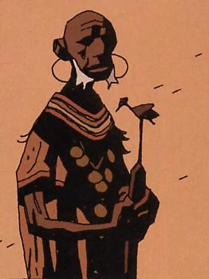

**Mohlomi** is an African witch doctor who is assumed to be dead over 200 years. Yet he is still alive and looks about 60 years old. He gave [Hellboy](/entry/Hellboy) a little bell in *Hellboy: [The Third Wish](/entry/The%20Third%20Wish)* \#1 to protect him from evil.

## History

In 1882, Mohlomi traveled to England to warn [Sir Edward Grey](/entry/Sir%20Edward%20Grey) about the threat of [Vladimir Giurescu](/entry/Vladimir%20Giurescu) and his master [Hecate](/entry/Hecate).

When Hellboy left the B.P.R.D. and traveled to Africa, he met with Mohlomi. The witch doctor protected him from the spirits of Africa who wished him harm.

## Background

The character is presumably loosely based on the the African philosopher, prophet and Healer Mohlomi who lived during the 1700's.

Mohlomi is a famous doctor who helped guide one of Africa's most prolific leaders King Moshoeshoe (of the Basotho people)and advised him on healing practices as well as other matters.

See also [Mohlomi Memorial lecture](http://www.lesotho.gov.ls/articles/2010/mohlomi_memorial_lecture.php).

**Category:Characters** **Category:Male Characters** **Category:Living Characters**