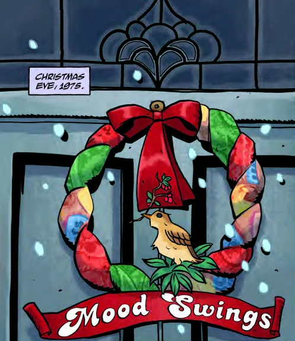

This short story originally appeared in the *[Hellboy Winter Special](/entry/Hellboy%20Winter%20Special)*. It is the Hellboy Universe debut of Chelsea Cain. The story focuses on [a young Liz Sherman](/entry/Elizabeth%20Sherman), [Hellboy](/entry/Hellboy), and [Trevor Bruttenholm](/entry/Trevor%20Bruttenholm) on Christmas Eve, 1975.

The story remains uncollected thus far.

**Category:Story**