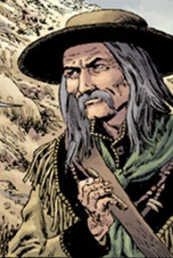

**Morgan Kaler** was a man living in Utah in 1880s, appearing in the Witchfinder story *[Lost and Gone Forever](/entry/Lost%20and%20Gone%20Forever)*.

## History

Morgan Kaler assisted [Sir Edward Grey](/entry/Sir%20Edward%20Grey) in his search for a [Lord Glaren](/entry/Lord%20Glaren), an influential member of the [Heliopic Brotherhood of Ra](/entry/Heliopic%20Brotherhood%20of%20Ra), but Kaler only did so as he believed something further was afoot after several people vanished after they were locked in a nearby church.

After surviving several attacks by zombies and a stone dog (mainly due to Kaler's expertise) the two came to the conclusion that a witch by the name of [Eris](/entry/Eris) was responsible for the disappearance of the church people and the zombie attacks. With the guidance of a Native American spirit, Grey managed to destroy the source of Eris' power and thus defeats her. Afterwards Kaler and Grey parted ways, likely to never see one another again.

In 1948 a local bar in Utah was named after a Kaler, it is unknown if this was after Morgan or one of his descendants.

**Category:Characters** **Category:Male Characters** **Category:Witchfinder Characters** **Category:Deceased Characters**