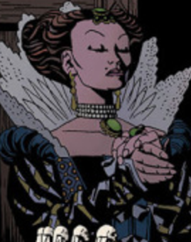

**Morgan Le Fay** was [King Arthur](/entry/King%20Arthur)'s half-sister, and the mother of his bastard son, Mordred.

Although Arthur's male line, and thus his name, died out, his lineage continued in a series of daughters, all witches, the last of whom was [Sarah Hughes](/entry/Sarah%20Hughes), [Hellboy](/entry/Hellboy%20%28character%29)'s mother. Morgan kept Arthur's sword, [Excalibur](/entry/Excalibur), for safekeeping, waiting until Arthur's male heir was born.

Morgan lived in a castle somewhere in Europe (or in some other plane of existence) that was constantly besieged by an army of demons, demanding collection of what Morgan had promised in exchange for her sorcerous powers.

After [Alice Monaghan](/entry/Alice%20Monaghan) was poisoned, Hellboy brought her in desperation to Morgan's castle. Morgan cured Alice, while revealing to Hellboy the true of his ancestry and urging him to take up the sword and claim his birthright. Hellboy, reluctant, asked why she cared, since she and everyone else she had cared about were long dead. She said simply, her son should have been king, so she will settle for making Hellboy king.

During the events of *[The Storm](/entry/The%20Storm)* and *[The Fury](/entry/The%20Fury)*, Morgan approached [Gruagach](/entry/Gruagach), who had released the Queen of Blood from her prison, and so unwittingly caused the death of Queen Mab and the extinction of his own race. Although [Merlin](/entry/Merlin) had cursed Gruagach to remain in the world for eternity and see the ruin of his own people, Morgan took pity on him, lifted the curse, and took him away from the carnage on Earth. Merlin, still trapped in the grave where the Queen had imprisoned him, could only howl impotently in protest.

**Category:Characters** **Category:Female Characters** **Category:Living Characters** **Category:Witches** **Category:Immortals**