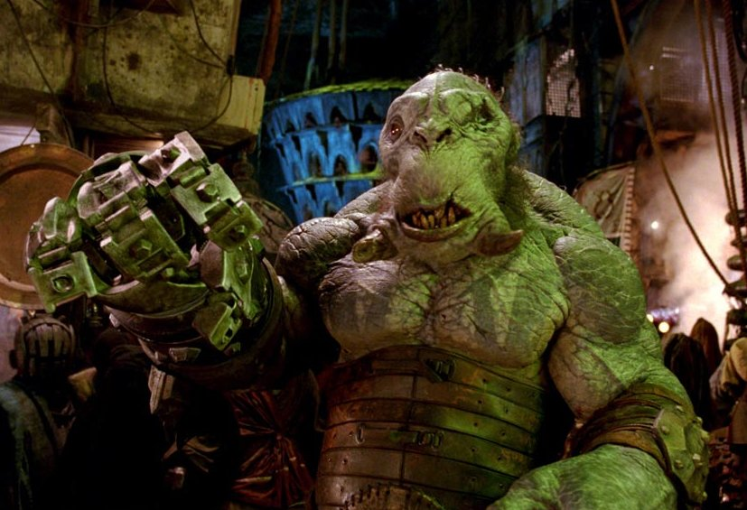

**Mr. Wink** is a Cave Troll who is a friend and henchman to Prince Nuada. His primary weapon is a mechanical fist, which is capable of being launched from his right arm tethered by a long chain, for attacking foes at a distance. It is reeled back into its mounting, often by crawling back to its owner. He has a metal armor plate that is so tough that even Red's punches can't break it. Mr Wink possesses substantial physical strength, capable of throwing human-sized opponents several dozen feet.

Thousands of years ago Mr. Wink fought in the war against the human race and during one of the battles he lost his right hand, however it was replaced with his launching mechanical fist. He later accompanied Prince Nuada into exile when he refused to follow the peace treaty with the humans.

## In [Hellboy II: The Golden Army](/entry/Hellboy%20II%3A%20The%20Golden%20Army)

Mr. Wink is first introduced as Prince [Nuada](/entry/Nuada) practices combat techniques with his spear, underneath the Manhattan Bridge.

Soon, they carry out a plot to raid an auction house to steal one of three pieces of the Crown of Bethmora, which when reunited will bring an army of clockwork warriors known as the Golden Army under the control of the wearer, provided he is of royal blood. They do this by raiding the auction house, then setting free thousands of ravenous tooth fairies who eat everyone at the auction house and later attack investigating agents of the [BPRD](/entry/Bureau%20for%20Paranormal%20Research%20and%20Defense)

Later, Wink is present when [Nuada](/entry/Nuada) overthrows and kills his father, King Balor.

Once the [BPRD](/entry/Bureau%20for%20Paranormal%20Research%20and%20Defense) learns of the plot, they trace the purchase of the tooth fairies to the near-mythic Troll Market, which has never been located by human authorities. [Hellboy](/entry/Hellboy%20%28character%29), [Abe Sapien](/entry/Abe%20Sapien) and new team member [Johann Kraus](/entry/Johann%20Kraus) manage to infiltrate the market. During their search on the market, Abe encounters Princess [Nuala](/entry/Nuala), [Nuada](/entry/Nuada)'s twin sister and holder of the third piece of the crown.

Following her to a nearby shop, Abe is soon attacked by Mr. Wink. Evading most of his attacks, he manages to hold out until Hellboy arrives. As Abe escapes with the Princess, Wink and Hellboy battle, with Wink at first having the advantage, seemingly impervious to Hellboy's punches. However, using the Right Hand of Doom, he manages to severely damage Wink's artificial fist, causing the troll to cry like a baby. Hellboy takes the advantage and seemingly wins the fight. Wink rises and tries to fire his damaged fist after Hellboy threw a lost tooth at him. Hellboy attempts to warn him about firing his fist, but Mr. Wink fails to heed and launches it anyway. However, it becomes lodged between the spiked rollers of a garbage crusher. Still attached to its chain, Mr. Wink is dragged into the contraption and crushed to death.

## Gallery

<File:Wink.jpg%7C600px%7CWink> with the tooth fairies. <File:Wink_014.JPG>

de:Mr. Wink

**Category:Villains** **Category:Trolls** **Category:Hellboy II: The Golden Army characters**