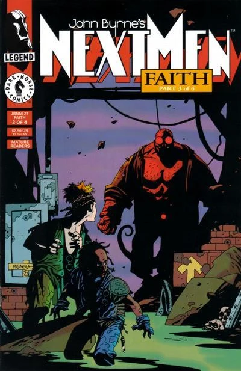

This story was the first color appearance of [Hellboy](/entry/Hellboy%20%28character%29). The story itself is metafictional, breaking the fourth wall by acknowledging not just that Hellboy is a comics character, but that he's drawn by Mike Mignola. The issue also includes a rare Mike Mignola double-page spread.

**Category:Out-of-continuity story** **Category:Crossovers**