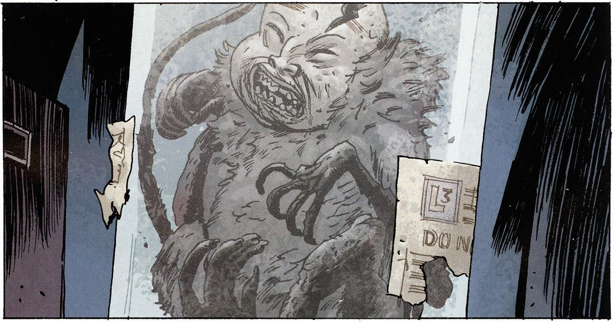

Very little is known about this creature, not even its real name. The creature is somehow connected to [Ben Daimio](/entry/Ben%20Daimio) and to his grandmother, the [Crimson Lotus](/entry/Crimson%20Lotus) and has been shown to posses the ability to mimic the voice of others.

## Name

The creature is never named in the comics themselves. The name *'Noh* monkey' comes from a sketch of the creature in the back of *[B.P.R.D. - Volume 7: Garden of Souls](/entry/Trade%20Paperback%20Collections)*.

## Appearances

The creature has only been seen in seven different issues, all from [B.P.R.D.](/entry/B.P.R.D.) comics.

### *[The Dead](/entry/The%20Dead)* \#3

A photograph of the [Crimson Lotus](/entry/Crimson%20Lotus) taken in 1941 shows her carrying what appear to be a living *'Noh* monkey. This is the only definite instance of a the creature as actually living in a B.P.R.D. comic.

### *[The Dead](/entry/The%20Dead)* \#5

While looking for weapons in the B.P.R.D. HQ subbasement, [Ben Daimio](/entry/Ben%20Daimio) finds a preserved *'Noh* monkey' in a jar. It is unknown whether this is the same creature pictured in *[The Dead](/entry/The%20Dead)* \#3 or a different one.

### *[The Black Flame](/entry/The%20Black%20Flame%20%28story%29)* \#2

Among [Landis Pope](/entry/Landis%20Pope)'s collection of Nazi paraphernalia, he has the remains of a *'Noh* monkey.' This demonstrates that at least two of these creatures once existed, as this is a separate specimen from the one found by [Ben Daimio](/entry/Ben%20Daimio).

### *[The Universal Machine](/entry/The%20Universal%20Machine)* \#2

[Ben Daimio](/entry/Ben%20Daimio) tells Liz and Johann the story of his death and resurrection in the Bolivian jungle. His unit had been massacred by jaguar creatures. As Daimio lay dying, he saw a *'Noh* monkey' radio in for help. It is unclear if this only happened in his head, or if the monkey was actually there.

### *[Garden of Souls](/entry/Garden%20of%20Souls)* \#1

While receiving treatment from the "Chinaman," [Ben Daimio](/entry/Ben%20Daimio) sees the preserved *'Noh* monkey' come to life. The creature talks to him and tells him "to keep everything in check." Daimio wakes up only to realize that the conversation was only in his head.

### *[Killing Ground](/entry/Killing%20Ground)* \#1

The creature in a jar is again seen in [Ben Daimio](/entry/Ben%20Daimio)'s room.

### *[Killing Ground](/entry/Killing%20Ground)* \#3

The *'Noh* monkey' is featured prominently on the cover of this issue.

The creature taunts [Ben Daimio](/entry/Ben%20Daimio) about his secret. This angers him so much that he throws the jar, shattering it and destroying what remained of the creature. It is again unclear if the creature was actually talking or if it is all in Daimio's head.

Several Noh monkeys also appeared in the [Lobster Johnson](/entry/Lobster%20Johnson%20%28series%29) issue [A Scent of Lotus](/entry/A%20Scent%20of%20Lotus), along side the [Crimson Lotus](/entry/Crimson%20Lotus). The attack the [Lobster Johnson](/entry/Lobster%20Johnson) with pistols in a burning building and again on Chinatown's rooftops. At least one monkey is shot and killed, being recovered by the police afterwards. It is likely this is the monkey found by Captain[ Daimio](/entry/Benjamin%20Daimio) in [The Dead](/entry/The%20Dead) as it is contained in a similar jar.

## *Noh*

*see also [Noh](http://en.wikipedia.org/wiki/Noh) on Wikipedia*

Noh is a traditional Japanese form of dance theater. The head of the creature appears to be based on masks portraying human characters (as opposed to demons and ghosts) in Noh performances.

**Category:Characters** **Category:Species** **Category:Mythical Creature** **Category:Monsters**