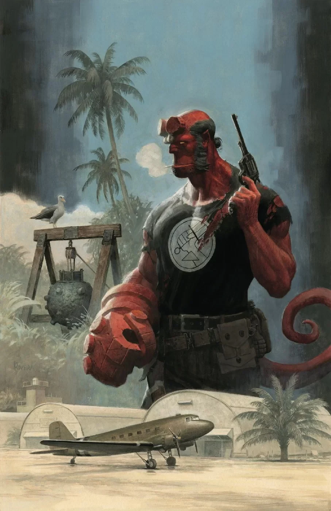
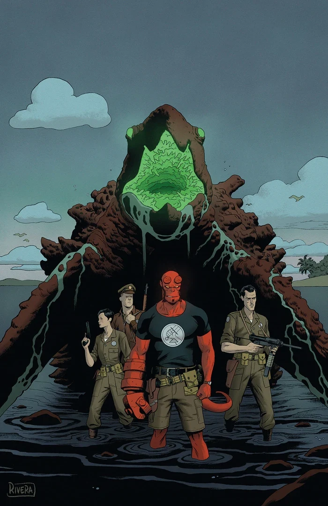
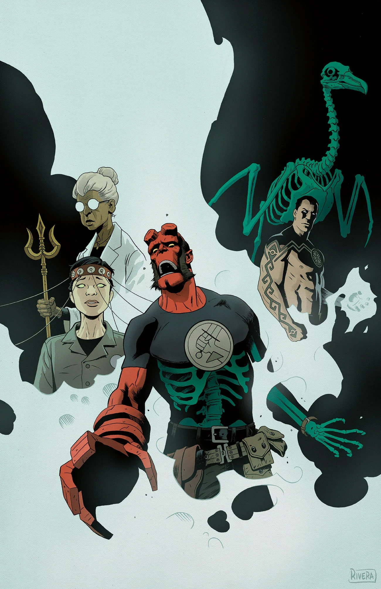

《**神秘学情报**》（Occult Intelligence）是《[地狱男爵与 B.P.R.D.](/entry/Hellboy_and_the_B.P.R.D.)：1955》的一个三期篇章，由迈克·米格诺拉（Mike Mignola）与克里斯·罗伯森（Chris Roberson）编剧，布莱恩·楚里拉（Brian Churilla）作画。

## 剧情简介

### 第一部

一次偏远小岛的中途停留，把地狱男爵卷入一张由政府机密与外国特工交织而成的阴谋之网——各方正为一件恰合 B.P.R.D. 本行的武器暗中展开冷战。在英格兰，布鲁滕霍尔姆挖出更多秘密，预示着一场席卷全球的超自然冲突即将爆发。

### 第二部

热带地区的谜局随着一头怪物的袭击而骤然升温，而这生物可能与一场国际冲突核心的秘密武器有所牵连。与此同时，布鲁滕霍尔姆自己的调查也表明：B.P.R.D. 已深陷一个比他所料庞大得多的局中。

### 第三部

岛上的袭击中竟有一位老对手的身影，B.P.R.D. 探员们大感意外；布鲁滕霍尔姆则深入追查，揭开这场国际超自然冲突背后的真相，以及 B.P.R.D. 在其中扮演的角色。

## 画廊

《神秘学情报》第 1 期

《神秘学情报》第 2 期

《神秘学情报》第 3 期

**Category:Story** **Category:B.P.R.D. story** **Category:Hellboy and the B.P.R.D. story** **Category:Hellboy story**
