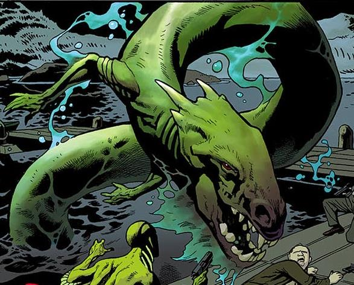

**Ogopogo** is a lake monster that inhabited Okanagan Lake in present day British Columbia.

## History

Ogopogo, or known as N'ha'ha'itq, was in reality a great spirit worshiped by the local people of the Shuswap and Okanagan. Over time, with the original people disappearing from Okanagan Lake, and without its worshipers, Ogopogo shrunk its size and became restless, and began attacking humans as early in the 1920's. Only Joe DeMille, a hermit and descendant of the original natives, was able to calm Ogopogo by singing an ancient song.

Ogopogo was investigated by Professor [Trevor Bruttenholm](/entry/Trevor%20Bruttenholm) and [Hellboy](/entry/Hellboy) in the 1960's, but weren't able to find the creature. May of 1992, Hellboy returned to Okanagan Lake with [Abe Sapien](/entry/Abe%20Sapien) regarding the death of Charlie Heppner caused by Ogopogo. The [B.P.R.D.](/entry/Bureau%20for%20Paranormal%20Research%20and%20Defense) agents soon learned that Heppner attempted to steal an idol tied to Ogopogo in which it provoked the lake monster's wrath.

After learning that Ogopogo's attack was self-defense, they were interrupted by Heppners accomplices. One managed to injure Joe, which caused Ogopogo to come to his aid in retaliation. Hellboy and Abe attempted to fight the monster by were at a disadvantage, until Joe sang causing the old god to calm down and retreat from whence it came.

## Powers & Abilities

According to Joe DeMille, he used to be ten times bigger and glowed. After he lost the faith of his worshipers he regressed into a giant serpent.

**Category:Monsters** **Category:Deities**