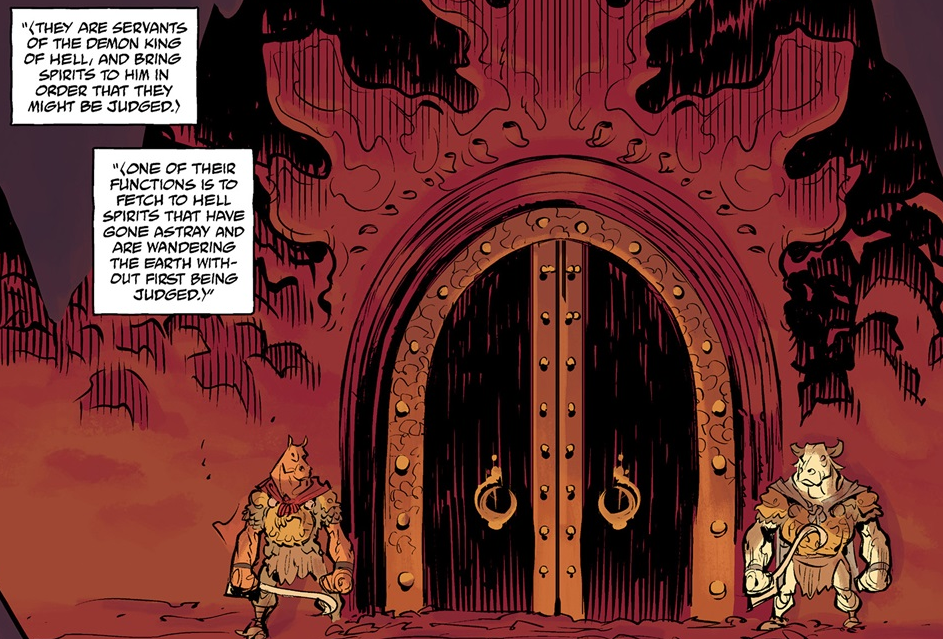

**Ox-Head and Horse-Face** are the two Asian demons charged in delivering souls to the afterlife.

## Background

 Ox-Head and Horse are servants of the Demon King of Hell, and bring spirits to him for judgement. Their purpose is to fetch Hell Spirits that have gone astray, wandering the Earth.

## History

In 1953, Ox-Head and Horse-Face manifested themselves on Earth after sensing a spiritual disturbance on the mortal plane. They appeared in the shanty town on the outskirts of Hong Kong. They learned that not only the visiting souls of the Ghost Moon Festival, but also the living inhabitants were taken and imprisoned. Determined to right this imbalance, the two demons tracked the disturbance to be a human sorcerer name Thomas Rhymes, who had used an artifact the [Hunping](/entry/Hunping) to trap the souls using them to empower him.

They were unable to apprehend the sorcerer as he utilized powerful warding upon his place of power, preventing them coming near him. The two demons ran afoul with the [Hellboy](/entry/Hellboy) and the [B.P.R.D.](/entry/Bureau%20for%20Paranormal%20Research%20and%20Defense) agents who they demanded that the souls be returned. A fight ensued between the two groups, but the fighting quickly stopped when the two demons noticed that the souls took priority.

When Hellboy managed to smash the artifact into pieces Ox-Head and Horse-Face returned the souls back to their proper places both to Hell and the living. They thanked their cousin Hellboy for this deed promising that the Demon King would remember it before flying off into the night.[1]

## Personalities

Unlike many European demons that possess sinister intentions and goals, Ox-Head and Horse-Face are in fact custodians of human souls. They see their duty as the utmost importance and were only enraged and committed to violence when unable to do their duty. They seem to be tempered creatures under normal circumstance, as they recognized Hellboy as one of their kin, yet held no grudges against him for working with humans or even after the beating he gave them in their brawl.

## Powers & Abilities

The demons were powerful entities, fighting on more than equal footing with Hellboy and coming out more or less unscathed from his beating. They were capable of aura detection, sensing the entrapped souls from dimensions away and capable of manipulating souls to return them to their proper vessels. They had a degree of shape-shifting abilities, growing a pair of wings for flight.

## References

<references />

**Category:Characters** **Category:Demons** **Category:Male Characters**

[1] [Ghost Moon](/entry/Ghost%20Moon)