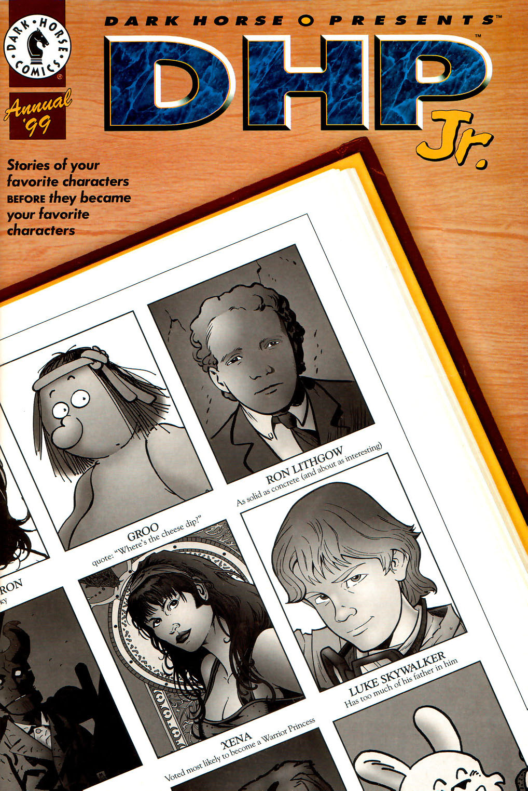

A young [Hellboy](/entry/Hellboy) eats pancakes.

## Publication History

*Pancakes* was published in black and white, as part of the *[Dark Horse Presents](/entry/Dark%20Horse%20Presents) Annual 1999*, in August 1999. The two page story was reprinted in color in *[Hellboy: vol. 4 The Right Hand of Doom](/entry/TPB)*.

## Synopsis

In 1947, a young [Hellboy](/entry/Hellboy) is called in for breakfast. He wants noodles, but is told he can only have pancakes. Hellboy does not want to eat pancakes, but tries one bite. Hellboy loves Pancakes. In Pandemoniumm, capital of Hell, the Demons wail. Three demon lords, [Astaroth](/entry/Astaroth), Mammon and Haborym, comment that now that Hellboy has eaten pancakes, he will never come back to hell.

## Story Chronology

This story takes place in 1947. Based on the fact that Hellboy asks for pancakes in [*B.P.R.D.: 1947* \#4](/entry/1947), *Pancakes* must take place before *1947*.

## Connections to Other Stories

In some ways this story is just a quick gag. However, this is the first appearance of the demon [Astaroth](/entry/Astaroth), who will make minor but significant appearances in *[Box Full of Evil](/entry/Box%20Full%20of%20Evil)* and *[The Wild Hunt](/entry/The%20Wild%20Hunt)*. Further, the idea of Hellboy's refusal to serve hell is a continuing theme in the series.

! colspan = 1 | [Vol. 3 The Chained Coffin and Others](/entry/TPB) ! colspan = 2 | [Vol. 4 The Right Hand of Doom](/entry/TPB)

**Category:Story** **Category:Hellboy story**