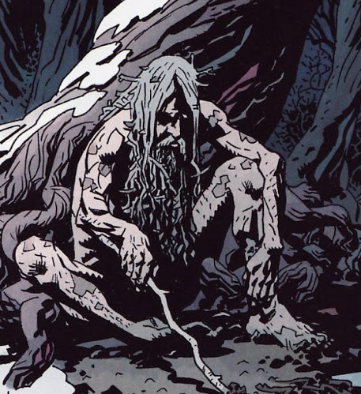

**Perun** was an ancient god of Slavic Mythology who acted as its highest god and lord of the Slavic Pantheon. He acted as God of Lightning and Thunder.

## History

### Darkness Calls

In 2007, [Hellboy](/entry/Hellboy) was turned over to the Baba Yaga, after refusing to be king of the Earth's witches. The Baba Yaga entrapped Hellboy in a parallel dimension controlled by her, where she attempted to destroy him with the undead army she had at her disposal. Hellboy was saved from the army only by the intervention of a pack of giant wolves ruled over by the [Leshii](/entry/Leshii), who offered Hellboy a one night sanctum in his woods. During this time Baba Yaga recruited [Koshchei the Deathless](/entry/Koshchei), an ancient soldier who couldn't die, to hunt down and kill Hellboy, or at the very least take his eye for her. While Hellboy slept, Leshii beckoned Perun to aid him in keeping the Baba Yaga’s armies from breaching his territory. Perun answered his plea by destroying Baba Yaga's army. In retaliation, Baba Yaga found Perun and killed him for assisting Hellboy by creating weather storms to impede Koschei's progress.

## Powers and Abilities

As the highest pagan god of an ancient pantheon of deities, Perun was an incredibly powerful being but had weakened over the years due to a lack of sufficient acknowledgment or worship. He was still powerful enough to conjure lightning storms by drawing figures of lightning in the dirt with a stick.

## Gallery

Perun's Power 001.png

**Category:Characters** **Category:Male Characters** **Category:Deceased Characters** **Category:Immortals** **Category:Deities**