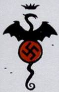

Project Ragna Rok logo.

**Project Ragna Rok** was a Nazi occult project, headed by [Grigori Rasputin](/entry/Grigori%20Rasputin), named after the climactic event of Norse mythology that was aiming at creating a Doomsday weapon which could end World War II and bring about a victory for Nazi Germany.

## Overview

During the last stage of the Second World War, confronted with the possibility of defeat, Adolf Hitler launched numerous “Doomsday” projects aimed at bringing about a Nazi victory, through either scientific or occult means. The Ragna Rok ("The Fatal Destiny") Project was one. During his meditations in Italy, Grigori Rasputin was approached by Heinrich Himmler to lead a group of Nazi occultists in building weapons of mass destruction. Eventually, after recognizing the potential in [Ilsa Haupstein](/entry/Ilsa%20Haupstein), [Leopold Kurtz](/entry/Leopold%20Kurtz), and [Karl Kroenen](/entry/Karl%20Ruprecht%20Kroenen), Rasputin assembled them as part of his Ragna Rok project.

Rasputin promised Hitler a “miracle” which would turn the tide of the war. Secretly, Rasputin hoped to trigger an apocalyptic event that would begin a new Eden.

On December 23, 1944, on Tarmagant Island, (a small island off the Scottish coast) Project Ragna Rok entered into its final phase. Rasputin called forth the key to the Apocalypse from Hell. Complications arose when the key did not appear on Tarmagant Island, but rather in a ruined church in East Bromwich, England. Even worse, the key, serving as the massive stone right hand of an infant demon, was recovered by the Allies. The demon would later become [Hellboy](/entry/Hellboy%20%28character%29), and his right hand would be much sought after. [Klaus Werner von Krupt](/entry/Klaus%20Werner%20von%20Krupt), Hitler's liaison with the project, viewed the project as a failure, and the team officially disbanded. Rasputin headed to the Arctic Circle in pursuit of a long-lost temple to the [Ogdru Jahad](/entry/Ogdru%20Jahad), while Haupstein, Kurtz, and Kroenen cryogenically froze themselves until Rasputin needed them once again.

## Team Members

### [Klaus Werner von Krupt](/entry/Klaus%20Werner%20von%20Krupt)

Hitler’s liaison with the project. Von Krupt believed Rasputin’s promises of a miracle, though he doubted the monk’s ability to deliver. Entirely unaware of Rasputin’s motives, he declared the project a failure when he failed to see results. Von Krupt died six months after being committed to Eisenvalt Sanitarium. His body was discovered to be infested with Beetles of unknown species or origin.

### [Leopold Kurtz](/entry/Leopold%20Kurtz)

A young Nazi occultist who threw his lot in with Rasputin and Project Ragna Rok. Kurtz relocated to a base in Norway with Kroenen and Haupstein after Rasputin’s failure at Cavendish Hall. When [Roderick Zinco](/entry/Roderick%20Zinco) found the severed head of [Herman von Klempt](/entry/Herman%20von%20Klempt), Kurtz registered his disapproval at von Klempt's inclusion in their plans. Kurtz later attacked the severed head after he caught it discussing Treason with Kroenen. Rushing to defend his old friend, Kroenen accidentally stabbed Kurtz to death.

### [Ilsa Haupstein](/entry/Ilsa%20Haupstein)

Another Nazi scientist recruited by Rasputin for his Ragna Rok project, Ilsa displayed extreme devotion and loyalty. After Rasputin's ghost returned from the failure at Cavendish Hall, she helped maneuver Hellboy into the hands of Hecate and the vampiric Count Giurescu. In an attempt to demonstrate her faith in Rasputin, she encased herself in a mystical Iron maiden (torture device) and immediately perished. Ilsa's blood powered the iron maiden, which partially allowed Hecate to survive death at Hellboy's hands.

### [Karl Ruprecht Kroenen](/entry/Karl%20Ruprecht%20Kroenen)

The perpetually-masked Kroenen attended University with Herman von Klempt. Recruited by Rasputin for the Ragna Rok project, Kroenen froze himself alongside Ilsa and Kurtz after the Tarmagant debacle, and resurfaced after the events at Cavendish Hall. Kroenen worked with Kurtz and Zinco, until Zinco’s discovery of von Klempt’s head. Moved by sympathy for his old colleague, Kroenen allowed von Klempt to tempt him into disobeying Rasputin. Kurtz overheard and attacked the head, forcing Kroenen to kill him. This triggered retribution by Rasputin's ghost which ended in a fiery explosion which killed both Zinco and Kroenen.

### [Grigori Rasputin](/entry/Grigori%20Rasputin)

After being assassinated by Prince Felix Yusopov on December 16th, 1916, Rasputin was revived and contacted by the Ogdru Jahad. They enlisted him as their mortal agent in the world. Soon after, Rasputin was contacted by the Nazis to begin development on an occult method for ending the war. From this, Project Ragna Rok was born. The Nazis sought to use Rasputin to defeat the Allies, but Rasputin knew this would never happen. He merely intended to use the Nazi’s resources as long as he could to achieve his own goals: to trigger the apocalypse which would jumpstart a new Eden.

Though the Nazis believed he had failed, Rasputin knew that he had summoned Hell on the night of the 23rd. With Hellboy in Allied care, it took him many years to engender a situation where he could use Hellboy to summon the Ogdru Jahad. Rasputin succeeded at Cavendish Hall, but was ultimately thwarted. He tried again when he forced Hellboy into a confrontation with Hecate, but Hellboy destroyed her mortal form and Rasputin's ghost retreated. Some time later, Hecate would find his aimless spirit and explain that he was nothing more than a pawn to the Ogdru Jahad. Rasputin, infuriated, attacked her and was virtually destroyed. The Baba Yaga kept a small piece of his soul in an Acorn she wore around her neck.

## Allies

### [Roderick Zinco](/entry/Roderick%20Zinco)

The wealthy industrialist Roderick Zinco, was selected as Rasputin's messenger to the members of the Ragna Rok Project. After nearly being killed by Leopold Kurtz, one of Zinco's contacts managed to get a hold of the disembodied head of Herman von Klempt. Outraged by this, Rasputin  destroyed the Ragna Rok base, killing Zinco and Kroenen.

### [Herman von Klempt](/entry/Herman%20von%20Klempt)

### [Unmensch](/entry/Unmensch)

A cyborg Nazi super-soldier in the service of Ilsa Haupstein, Unmensch fights Hellboy when assisting Haupstein in locating the body of [Vladimir Giurescu](/entry/Vladimir%20Giurescu). During the fight, the two fall through the floor, during which Unmensch looses his arm. Unmensch disappears, but his disembodied head is later found by Giurescu's coffin.

**Category:Organizations**