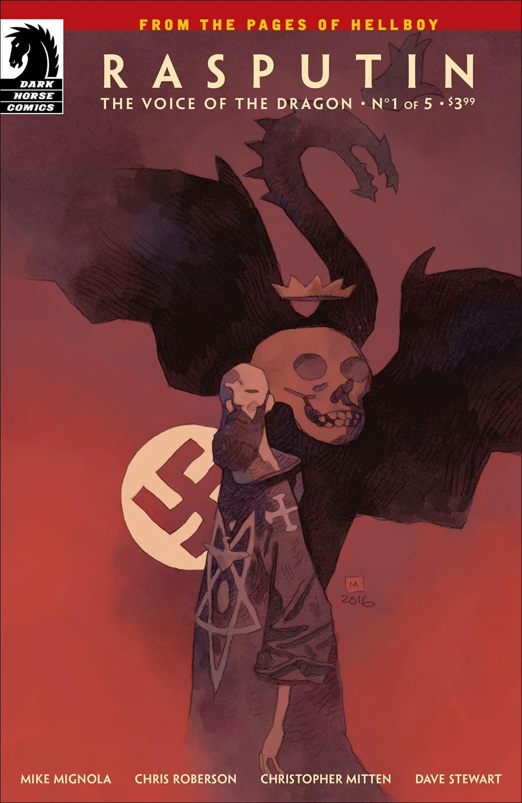

***Rasputin: The Voice of the Dragon*** is a five-issue miniseries written by Mike Mignola and Chris Roberson with art by Christopher Mitten.

## Synopsis

### Part One

A conspiracy involving the Third Reich and a dead member of a sinister secret society sets Professor Bruttenholm on his first mission—to find the man who’d soon bring Hellboy to earth. The mad Russian sorcerer Rasputin had been thought dead since 1916, when a group of noblemen sought to end his influence over the Tsar. Now Rasputin works with the most twisted members of Hitler’s inner circle, and he’s about to cross paths with the man who’ll go on to found the Bureau for Paranormal Research and Defense.

### Part Two

A séance reveals that Bruttenholm’s mission may be more than he bargained for when the stakes become more dangerous but the enemy only more mysterious.

### Part Three

Rasputin’s allies pursue their own goals as Professor Bruttenholm parachutes into Nazi territory in search of “The Master.”

### Part Four

Bruttenholm and Sandhu’s mission to uncover the evasive “Master” behind the Nazis occult experiments is derailed when they fall into the clutches of their enemy.

### Part Five

Bruttenholm and Sandhu reach the site of the Nazis' occult activity, where the shadowy Master himself is about to complete his occult experiment.

## Gallery

文件:Rasputin-TVotD1.jpg|Issue \#1 文件:Rasputin-TVotD1 Mignola.jpg|Issue \#1  
(Mike Mignola variant) 文件:Rasputin-TVotD2.jpg|Issue \#2 文件:Rasputin-TVotD2 Manchess.jpg|Issue \#2  
(Greg Manchess variant) 文件:Rasputin-TVotD3.jpg|Issue \#3 文件:Rasputin-TVotD3 Francavilla.jpg|Issue \#3  
(Francesco Francavilla variant) 文件:Rasputin-TVotD4.jpg|Issue \#4 文件:Rasputin-TVotD4 DelRey.jpg|Issue \#4  
(Vanesa R. Del Rey variant) 文件:Rasputin-TVotD5.jpg|Issue \#5 文件:Rasputin-TVotD5 Kaluta.jpg|Issue \#5  
(Michael Kaluta variant)

**Category:Story** **Category:Comics**