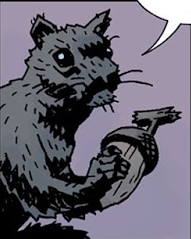

**Ratatosk** is a squirrel from Norse mythology said to run up and down the world tree, Yggdrasil.

## History

### *[Hellboy: The Bones of Giants](/entry/Hellboy__The_Bones_of_Giants)*

Ratatosk appears before Hellboy, possessed by the spirit of the Thunderer, and gave him warning of Thyrm and his allies. He later appeared alongside Mist, after Hellboy vanquished Thyrm.

### *[Hellboy: Darkness Calls](/entry/Darkness%20Calls)*

At Yggdrasil, a squirrel worries aloud that Ragnarok has come with the death of [Vasilisa](/entry/Vasilisa), but one of the [Baba Yaga](/entry/Baba%20Yaga)'s soldiers shoots him and he dies.

**Category:Characters** **Category:Male Characters** **Category:Immortals** **Category:Deceased Characters**