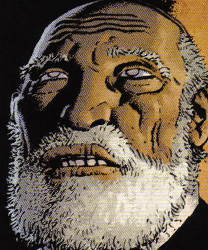

Reverend Watts is the sole priest of a dilapidated church near the area known as The Hurricane. Despite losing most of his followers to the increasing number of witches he is not afraid of [Jeremiah Witkins](/entry/Jeremiah%20Witkins) and his minions. Instead he helps [Tom Ferrell](/entry/Tom%20Ferrell) and Hellboy to combat the Crooked Man, withstanding some mighty temptations the reverend infuses the [Lucky cat bone](/entry/Lucky%20cat%20bone) with the holy spirit and blesses a shovel that Hellboy uses to whack the miser out of the fray. He then helps them bury Tom's father in the churchyard and agrees to help Tom put up a marker for Cora Fisher later.

## Powers and abilities

Reverend Watts is blind but has some degree of second sight as his dress is immaculate and he can perceive ghosts like [Cora Fisher](/entry/Cora%20Fisher) as well as the true nature of whomever he encounters.

He's also capable of imbuing items with "holy spirit" to make them rather effective against evil and it's minions. He also used prayer to remove the illusory youth and sight from his being that Miser Witkins had attempted to bribe him with. His greatest powers though are steadfastness and understanding of the human heart.

### Trivia

- Reverend Watts appearantly does at some level regret that he did not marry.

<!-- -->

- It's not know if he was blind from birth or through some misfortune in later life.
- Though not actually seen in the comic, it'slikely that Tom Ferrell and Hellboy made good on their intention of repairing the church for him.

**Category:Priests** **Category:Characters** **Category:Male Characters**