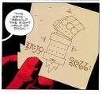

A drawing of Hellboy's arm, as seen in '<a href="The_Right_Hand_of_Doom" title="wikilink">The Right Hand of Doom</a>'.

The **Right Hand of** Doom is the stone hand given to [Hellboy](/entry/Hellboy%20%28character%29) by his father, [Azzael](/entry/Azzael), shortly after being born.

## Overview

The Right Hand of Doom consists of a large forearm and hand that seem to be made from red stone. Though now it has become Hellboy's substitute right arm (due to Azzael hacking off his original right hand as a baby and grafting the Hand in its place), the hand is effectively invulnerable and feels no pain, and is much like a sledgehammer when used to punch an enemy. Of course, being far larger than an ordinary human hand (or even Hellboy's own left hand), the Right Hand of Doom is not very suitable for use with most objects, although it has proven dexterous enough to catch a fly. Hellboy relies on his average-sized left hand to operate weapons and devices. Because of this, he is most likely ambidextrous.

The Right Hand of Doom was formerly the right hand of one of [Anum](/entry/Anum), one of the "[greater spirits](/entry/Watchers)" that watched over the burgeoning Earth, and is the hand the spirit used to create the dragon [Ogdru Jahad](/entry/Ogdru%20Jahad). With that same hand, he bound the dragon, but then his fellow spirits turned upon him for his deeds, and destroyed him utterly—sparing only his right hand, which was kept and preserved by many races throughout history, including the first race of man.

As the hand which created and bound the Ogdru Jahad, it is also the key which will "loose and command" them; being something of a catalyst that will bring about the world's end.

It is not even necessary for the arm to be attached to Hellboy at all; even on its own it would perform its tasks. However, it has been suggested that if Hellboy dies while the Hand is attached to him, it would become useless. He has thus come to the conclusion that the only way to prevent it falling into the wrong hands is to keep and protect it.

**Category:Items**