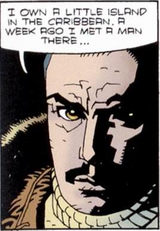

[Roderick Zinco](/entry/Roderick%20Zinco) was a wealthy man and founder of his company, the [Zinco Corporation](/entry/Zinco%20Corporation), chosen by [Rasputin](/entry/Rasputin) to be a messenger to the members of the [Ragna Rok Project](/entry/Project%20Ragna%20Rok).

## History

Roderick Zinco was a wealthy industrialist sent by Grigori Rasputin (whom Zinco referred to him as "The Master"), to contact the members of Project Ragna Rok at their secret base in Norway. Immediately upon entering the base Zinco just barely survived an encounter with the deranged Occult scientist [Leopold Kurtz](/entry/Leopold%20Kurtz). After, explaining how he encountered the master on his private island, Zinco's life was spared. One year after his arrival, under orders of [Doctor Kroenen](/entry/Karl%20Ruprecht%20Kroenen), one of Zinco's contacts managed to acquire the head of the German scientist [Herman von Klempt](/entry/Herman%20von%20Klempt). Enraged by this, Kurtz brutally attacked Kroenen, but was fatally stabbed with a scalpel. Furious with Kroenen and Zinco, for their traitorous actions, the master struck Zinco blind. Sightless, Zinco accidentally destroyed the Ragna Rok base, taking Kroenen and Zinco with it. 

## Hellboy II: The Golden Army

In an animated special feature, as part of the DVD edition of *[Hellboy II: The Golden Army](/entry/Hellboy_II__The_Golden_Army)*, Roderick Zinco and his company appears in the *Zinco Epilogue*where he finds the severed head of Colonel Kroenen. There, Zinco also encounters the ghost of Grigori Rasputin.

**Category:Characters** **Category:Male Characters** **Category:Deceased Characters** **Category:Americans** **Category:Zinco Corporation**