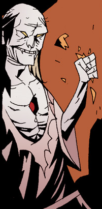

**Romulus Diovanni** was a vampire count from 12th Century Italy.

## History

Romulus Diovanni was originally a rich son of an old family, who spent his life entertaining his appetite for excess. His home in Venice became a renowned brothel. According to legend his behavior attracted the attention of a vampire from Rome. The two became friends, until the vampire refused Diovanni's request for immortality. Diovanni bound his former compatriot, torturing him for many years, but the vampire refused to make him immortal. Diovanni eventually killed the vampire, drinking his blood becoming a vampire himself. After that he became a blood thirsty mad-man supposedly murdering hundreds. He was reported to have been burned at the stake by the Knight's Templar in the Piazza St. Marcos in 1299.

According to legend his ghost resides in his house, with everyone who tried to live there having gone mad. [B.P.R.D.](/entry/Bureau%20for%20Paranormal%20Research%20and%20Defense) agents [Liz Sherman](/entry/Liz%20Sherman), [Johann Kraus](/entry/Johann%20Kraus), [Abe Sapien](/entry/Abe%20Sapien) and [Roger](/entry/Roger) came to Venice to investigate as to why the canals suddenly became polluted. Johann Kraus tracked the disturbance of evil to the old vampire house, where they found his coffin. Abe immediately thrusted a stake in the vampire's heart, strangely it had no effect on the vampire. Diovanni awoke and proceeded to immobilize the agents with gas and illusions.

When he thought that his interlopers were put down he began a ritual to summon the Great Marquis [Shax](/entry/Shax). He revealed after six hundred years he finally captured the goddess [Cloacina](/entry/Cloacina) and offered it to the demon lord in exchange for command of his thirty legions. The demon rejected him and demanded to be released. Roger who awoke from the gas attacked the vampire, shattering the contain trapping the goddess. The blinding light caused Dionvanni to be vaporize to bones.[1]

## Powers & Abilities

Dionvanni was a vampire ghost, thus was unable to be killed through a stake through the heart. He possessed power of illusions and could cause people to bleed through their eyes. Direct light was harmful to him like all vampires.

## References

<references />

**Category:Characters** **Category:Male Characters** **Category:Vampires** **Category:Deceased Characters**

[1] [The Soul of Venice](/entry/The%20Soul%20of%20Venice)