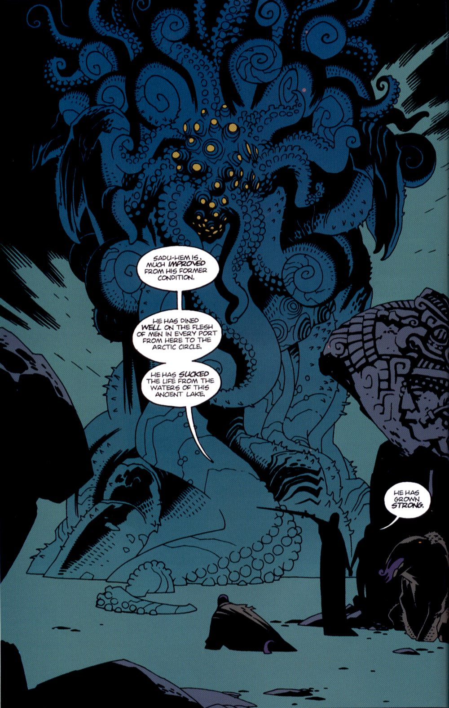

The **Sadu-Hem** was one of the 369 Ogdru Hem, the children of the [Ogdru Jahad](/entry/Ogdru%20Jahad).

## History

Imprisoned on Earth so that the [Ogdru Jahad](/entry/Ogdru%20Jahad) would "*always have a foothold in the world from which they were banished*", Sadu-Hem was discovered by [Grigori Rasputin](/entry/Grigori%20Rasputin) in the Gorinium temple at the top of the Arctic circle. Rasputin remained in a trance near the statue until the arrival of Professor [Trevor Bruttenholm](/entry/Trevor%20Bruttenholm) and the Cavendish exploration party. The newly-awakened Rasputin and Sadu-Hem devoured most of Bruttenholm's exploration party. Bruttenholm was allowed, under heavy psychological compulsion, to return to America, where Rasputin and Sadu-Hem installed themselves below Cavendish Hall. Physically, Sadu-Hem appeared as a gruesome mass of tentacles and snapping claws, with a cluster of eyes and feelers serving as its head. Sadu-Hem was to act as the conduit between Rasputin and the Ogdru Jahad, but was destroyed after [Abe Sapien](/entry/Abe%20Sapien) speared Rasputin to death and [Liz Sherman](/entry/Liz%20Sherman) set the entire place on fire.

### Plague of Frogs

Although Sadu-Hem was apparently destroyed, a small piece of him was discovered in the Cavendish Hall ruins over a decade later by the [B.P.R.D.](/entry/B.P.R.D.) Director [Thomas Manning](/entry/Thomas%20Manning) had the specimen of fungus preserved in a New Jersey lab, until Sadu-Hem grew strong enough to absorb a human form and escape. Fleeing to Crab Point, Michigan, Sadu-Hem converted an entire town into vicious frog monsters before he was again immolated by Liz Sherman.

## Gallery

Sadu-Hem.png

**Category: The Ogdru Jahad and their Agents** **Category:Ogdru Hem** **Category:Hellboy characters**