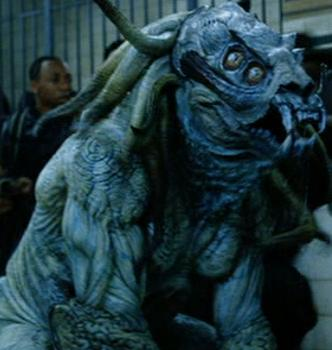

**Sammael the Desolate One**, also known as **Lord of the Shadows**, **Harbinger of Pestilence**, **Seed of Destruction**, and **Hound of Resurrection**, was one of the main antagonists in the *[Hellboy](/entry/Hellboy%20%28film%29)* film. Sammael is a hellhound in which his essence was preserved and sealed within salt; crystals formed and gathered from the tears of a thousand angels. He was described as a "Son of Nergal", one of the seven [Ogdru-Jahad](/entry/Ogdru%20Jahad), which implies that he is an Ogdru Hem. When Sammael was brought forth in the modern world of 2004, the creature was cast with a spell by [Grigori Rasputin](/entry/Grigori%20Rasputin), where for each "*one of \[him\] that falls, two shall arise*".

## Abilities

Aside from the obvious superior strength and agility he possesses, Sammael also possessed incredible regenerative abilities, earning him the title of "Hound of Resurrection". This allowed him to dislocate his limbs to reach in directions that most creatures cannot, with any broken bones or sustained injury inflicted on his body can be regenerated back to its original form. However this does not mean that Sammael is immune to death as grievously injuring his body is known to incapacitate him for several minutes. Therefore, it was shown to be extremely difficult to fatally injure the creature, as it took explosions, electricution, incineration, and otherwise extreme bodily damage, such as being crushed, to for him to be killed. This was negated by Sammael's ability to split his essence into two, allowing him to be reborn and grow in numbers each time one falls.

Each Sammael was capable of laying a cluster eggs, specifically in dark and wet environments, as they were sensitive to heat and light. When one Sammael was killed, two of these eggs break away and rapidly matured until there were twin clones of the monster. This process repeated itself every time one was killed, thereby allowing Sammael to multiply himself and grow in numbers.

In the movie, it was implied that the only known way to permanently destroy Sammael without causing him to be reborn is to destroy all the cluster of eggs along with any available clones of the creature in one fell swoop. Though, considering his essence had been magically bound with the tears of a thousand angels in the first place, either it was an unnecessary religious precaution to prevent a possible resurrection or Sammael could be resurrected from mere bones and ashes, as Rasputin demonstrated.

In the very last scene of the first movie, a roar is heard. Sammael isn't shown to be the one to have produced the sound but it hints to the protagonists' failure at getting rid of the Hound of Resurrection which could either give ground to the above theory or simply means they weren't able to destroy all the eggs.

- **Strength:** Sammael was shown to possess equal or greater strength than Hellboy.
- **Mobility:** As a quadruped, Sammael can attain great speed at a full run and is able to move with agility that is superior to most living creatures.
- **Regeneration:** Sammael can recover rapidly from tissue damage and broken bones.
- **Endurance:**Sammael can withstand intense physical assault, including high impact trauma from gunshots.
- **Stamina:** Sammael is able to run for extended periods without obvious signs of exhaustion.
- **Acute Senses:** Sammael has a pronounced olfactory sense.
- **Climbing:** Sammael's clawed extremities afford him a pronounced ability to find purchase enough to scale sheer walls. His strength and claws are sufficient enough to puncture plate steel.
- **Melee:** Sammael was shown to be capable of engaging in melee combat on par with Hellboy. He is also capable of using his right ulna as a retractable club for climbing and striking his opponents; in which it was strong enough to smash through steel and concrete. 
- **Prehensile Tongue:** Sammael has a very long three-pronged tongue used to latch and impregnate victims with its eggs.

## Trivia

- In Judaism, Samael is a name derived from the Hebrew word *סמאל*, simply translatable as divine punishment or retribution. Samael is the Archangel of Death: a destroyer, ruler of the Fifth Heaven and served by two million Angels. Samael has often been depicted as an angelic being (once as a cross between a lion and fish).
- Sammael was designed to have some similarities to the Frog monsters, one of epithets playing on the *Seed of Destruction* storyline that the film was based on.
- As its epithet "Son of Nergal" refers one of the seven Ogdru-Jahad, Nergal-Jahad, Sammael could count as an Ogdru Hem.

de:Sammael

**Category:Male Characters** **Category:Species** **Category:Mythical Creature** **Category:Monsters** **Category:Villains** **Category:Deceased Characters** **Category:Demons** **Category:Hellboy (2004 film) characters**