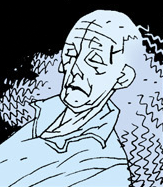

**Sarah Hughes**is the mother of Hellboy. She comes from a long line of witches whose lineage can be traced back to the daughter of the witch Katheryn of Gilfach and Mordred, the bastard son of King Arthur and his half sister, [Morgan Le Fey](/entry/Morgan%20Le%20Fey). From Katheryn of Gilfach to Sarah Hughes was an unbroken line of daughters, all witches.

Sarah Hughes had three children of her own, a son that became a monk, a daughter that became a nun, and a half-demon that would one day come to be known as [Hellboy](/entry/Hellboy%20%28character%29). Hellboy was conceived first, on Walpurgis Night, 1574. Sarah Hughes was only sixteen at the time, and married [Azzael](/entry/Azzael), Hellboy's demon father.

In 1617, on her deathbed, Sarah Hughes repented her evil deeds in the presence of her two human children. They were instructed to chain her in her coffin. If they could keep her from her husband for three nights, Azzael's claim to her would be broken. On the 6th of October, the first evening after her death, Azzael came, and murdered Sarah's human children. He took Sarah down into Hell, where she was engulfed in flame, and from this Hellboy was born, King Arthur's first male heir since Mordred.

**Category:Characters** **Category:Female Characters** **Category:Witches** **Category:Deceased Characters** **Category:Humans**