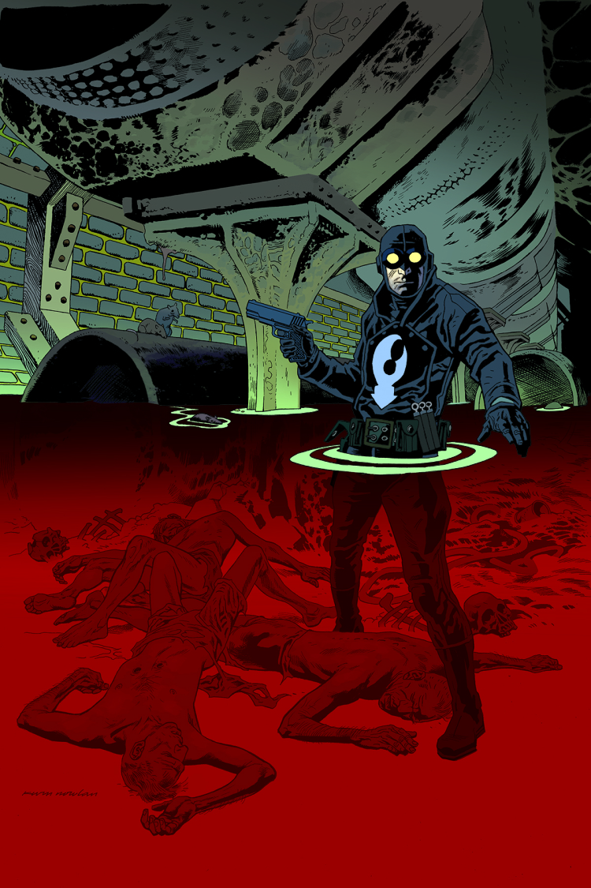

The story takes place early in [the Lobster's](/entry/The%20Lobster) career as a crime fighter in the 1930s.

## Publication History

This one-shot will be published in 2013, with a cover and art by Kevin Nowlan.

## Synopsis

Someone is killing off skid row bums and dumping their corpses. The only one who can deliver justice is Hellboy’s favorite gun-blazing vigilante.

## Gallery

<File:Satan> Smells a Rat.jpg|Cover

! colspan = 3 | [ Vol. 3 Satan Smells a Rat](/entry/TPB)

**Category:Story** **Category:Lobster Johnson story**