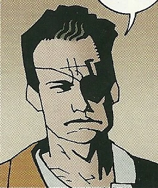

**Scott Clark** was a [B.P.R.D.](/entry/B.P.R.D.) Field Agent that participated in the search for [Vladimir Giurescu](/entry/Vladimir%20Giurescu)'s castle.

## History

Clark was assigned to search for Vladimir Giurescu's castle alongside fellow agent [Abe Sapien](/entry/Abe%20Sapien). After their search, Clark and Sapien attempted to locate the missing [Hellboy](/entry/Hellboy). The two traced him to a church in Romania, only to find Hellboy's belt signal, and the head of Father Nicholas Bundez. After realizing that they had been tricked, they fell through the church floor, where Clark was impaled on one of the spikes below. This was a trap for Sapien, set by [Grigori Rasputin](/entry/Grigori%20Rasputin).

## Trivia

Clark's physical appearance greatly resembles that of famous Marvel Comics character Nick Fury. He is also seen using a jet-pack, something that Nick Fury has been known to do on very many occasions. It is likely that Mike Mignola intended this as an homage.

**Category:Characters** **Category:B.P.R.D. agent** **Category:Humans** **Category:Deceased Characters** **Category:Male Characters** **Category:Americans**