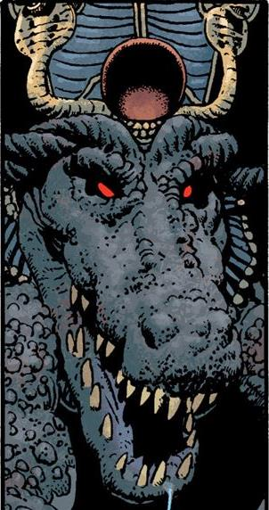

**Sebek** is the Egyptian crocodile god.

## History

In 1960, Gale University, Northborough an insane gift shop clerk, claiming to be the Pharoh Thesh, attempted to sacrifice a woman who had scorned him. He was stopped by Hellboy who smashed his reanimated mummies to dust, Thesh then ran through the Egyptian Wing of the musuem, taking refuge in the exibit featuring the Temple of Sebek. Thesh invoked the wrath of Sebek when he called for Horus to protect him in his temple. Sebek appeared and devoured him for his ignorance.

**Category:Characters** **Category:Male Characters** **Category:Deities**