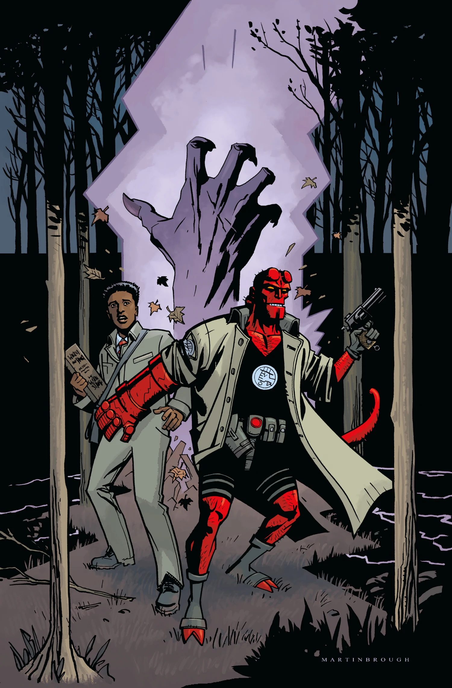

《**隐秘天性**》（Secret Nature）是《[地狱男爵与 B.P.R.D.](/entry/Hellboy_and_the_B.P.R.D.)：1955》的一个单期完结篇章，由迈克·米格诺拉（Mike Mignola）与克里斯·罗伯森（Chris Roberson）编剧，肖恩·马丁布拉夫（Shawn Martinbrough）作画。

## 剧情简介

俄勒冈州偏远林地里一群少年失踪，这让[地狱男爵](/entry/Hellboy_(character))与伍迪（[Woody](/entry/Woodrow_Farrier)）不得不直面一头神秘生物——而它的起源，竟与地狱男爵自己有着惊人的相似！

## 画廊

封面由 [肖恩·马丁布拉夫](/entry/Shawn_Martinbrough)（Shawn Martinbrough）绘制。

《隐秘天性》

**Category:Story** **Category:B.P.R.D. story** **Category:Hellboy story** **Category:Hellboy and the B.P.R.D. story**
