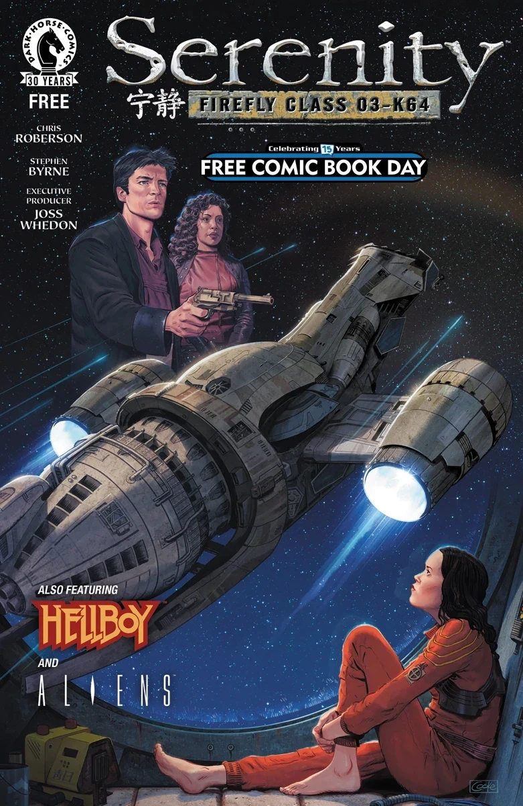

*本条目仍是一个小作品（stub）。你可以帮助地狱男爵维基扩充它。*

***《Serenity（冲出宁静号）／Hellboy（地狱男爵）／Aliens（异形）：免费漫画日 2016》*** 是 2016 年 5 月推出的一部合集特刊，收录三个故事。地狱男爵宇宙故事 *[《镜子》](/entry/The_Mirror)* 也在本期首次登场。

## 宣传文案

还需要一个理由入手黑马漫画 2016 年免费漫画日的刊物吗？这里有三个：Mike Mignola 与 Richard Corben 带来一则取自地狱男爵过往的教训；Brian Wood 以一则原创故事让人先睹 *《异形：反抗》（Aliens: Defiance）* 系列的风采；还有来自 Joss Whedon 世界的篇章——在电影和大热剧集续作 *《风中落叶》（Leaves on the Wind）* 之后，一窥宁静号船员们的近况。

## 收录故事

- 《战士与风》（The Warrior and the Wind），编剧 [Chris Roberson](/entry/Chris_Roberson)，作画 Stephen Byrne
- *[《镜子》](/entry/The_Mirror)*，编剧 [Mike Mignola](/entry/Mike_Mignola)，作画 [Richard Corben](/entry/Richard_Corben)
- 《舱外》（Extravehicular），编剧 Brian Wood，作画 Tristan Jones

---

**【站长封面考据】为什么封面上会有“宁静”两个汉字？（2026-09-15）**

今天整理到这则小条目时，我先被封面绊了一下：这明明是黑马漫画（Dark Horse Comics）2016 年的美国免费漫画日赠刊，为什么海报式封面的大标题下面，会赫然出现两个中文汉字“宁静”？第一反应是怀疑图片来源有问题——会不会是 Fandom 用户后加的水印、中文站点涂改图，或者迁移时拿错了亚洲版封面？

追查过程如下：

1. **先核对本地三层文件。** 英文冻结层 `pages_en/` 与机翻中文层 `pages_mt/` 引用的都是同一张图：`/content/images/FCBD%202016.webp`；中文层没有替换图片，也没有额外叠加任何图层。服务器上的文件虽然扩展名是 `.jpg`，实际文件头为 WebP，尺寸 781×1200，正是从 Hellboy Fandom 快照迁移来的封面文件。
2. **再放大封面本身。** 顶部是巨大的金属质感英文船名 **Serenity**；船名下方、铭牌 **FIREFLY CLASS 03-K64** 左侧，有两个白墨、手写剥落质感的汉字“**宁静**”。它和英文标题共用同一套星空背景、做旧质感和排版网格，边缘不是后期贴片或半透明水印；左下角同时还有 Hellboy 与 Aliens 的标志。
3. **追溯这两个字的含义。** “Serenity”直译就是“宁静、安宁”，汉语拼音为 **níng jìng**。它在这里不是形容词，而是《萤火虫》（Firefly）世界观里那艘 **Firefly Class 03-K64** 运输船的船名；2005 年电影版中文通称为《冲出宁静号》。
4. **确认为什么美国科幻作品会原生使用中文。** 《萤火虫》的未来设定中，中英双语都是联盟（Alliance）世界的重要语言，剧中本来就大量出现中文招牌、中文粗口和东方化视觉元素。Serenity 的官方漫画与周边视觉长期把“宁静”二字放在英文船名旁，作为船名标识的一部分。因此这两个字不是中文汉化组添加，也不是 Fandom 添加，而是黑马官方封面设计自带。
5. **核对刊物时间与内容。** 这期是 **Free Comic Book Day 2016** 的黄金档（Gold）赠刊，随 2016 年 5 月 7 日免费漫画日在漫画店发放。封面同时标注 Dark Horse 的“30 YEARS”和 Firefly 的“Celebrating 15 Years”，所以主视觉明显偏向 Serenity；Hellboy 与 Aliens 只以“also featuring”的标志形式出现。

本期收录三个短篇：

- **Serenity：《The Warrior and the Wind》（战士与风）**，Chris Roberson 编剧、Stephen Byrne 作画。故事里 River 给 Zoe 与 Wash 的小女儿讲睡前故事，时间线接在电影与《Serenity: Leaves on the Wind》之后。
- **Hellboy：《镜子》（The Mirror）**，Mike Mignola 编剧、Richard Corben 作画。这是该故事的首次发表，后来收入《Hellboy: The Complete Short Stories Volume 2》。
- **Aliens：《Extravehicular》（舱外）**，Brian Wood 编剧、Tristan Jones 作画，作为同年《Aliens: Defiance》系列的预热原创故事。

**结论：** 源漫画封面就是这样。图片确实来自 Hellboy Fandom 的官方封面存档，但 Fandom 只是转载了黑马的原版封面；“宁静”是 *Serenity / Firefly Class 03-K64* 官方标识的一部分，含义就是船名“宁静号”。它不是汉化痕迹，反而是《萤火虫》宇宙“中英双语未来”这个核心视觉设定的一个漂亮注脚。

以上判断同时核对了 Free Comic Book Day 2016 黄金档赠刊名单、Dark Horse 官方预告、Serenity 漫画出版资料以及 Firefly / Serenity 中文标识资料。
