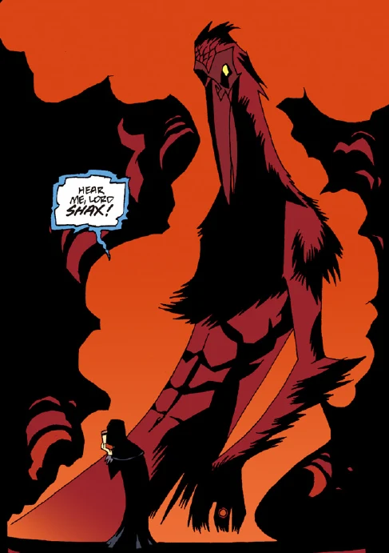

**Shax** was a demon who held the rank of Great Marquis of Hell.

## History

Shax was summoned by [Romulus Diovanni](/entry/Romulus%20Diovanni) in an attempt to gain favor from the demon lord. Diovanni offered him the soul of the old deity [Cloacina](/entry/Cloacina) in exchange for power to rule over the Earth. However the demon was not impressed. He demanded to be released, no longer wishing to be associated with Diovanni seeing him as a scavenger. While Diovanni was distracted by his rejection from Shax, [Roger](/entry/Roger) managed to break the container imprisoning Cloacina. Diovanni was unable to handle the divine light and turned to bones, one of his bones breaking the seal trapping Shax. The demon thanked the homunculus for freeing him but inquired where [Hellboy](/entry/Hellboy) was. He was slightly disappointed that Hellboy wasn't present but asked Roger to pass a greeting before returning to Hell.[1]

After the death of [Satan](/entry/Satan), Shax was one of the casualties of the slave rebellion. His soldiers turned on him upon crossing the Phlegethon.[2]

## Powers and Abilities

According to Diovanni he commanded thirty legions.

## References

<references />

**Category:Characters** **Category:Male Characters** **Category:Demons** **Category:Deceased Characters** **Category:Royalty**

[1] [The Soul of Venice](/entry/The%20Soul%20of%20Venice)

[2] [The Spanish Bride](/entry/The%20Spanish%20Bride)