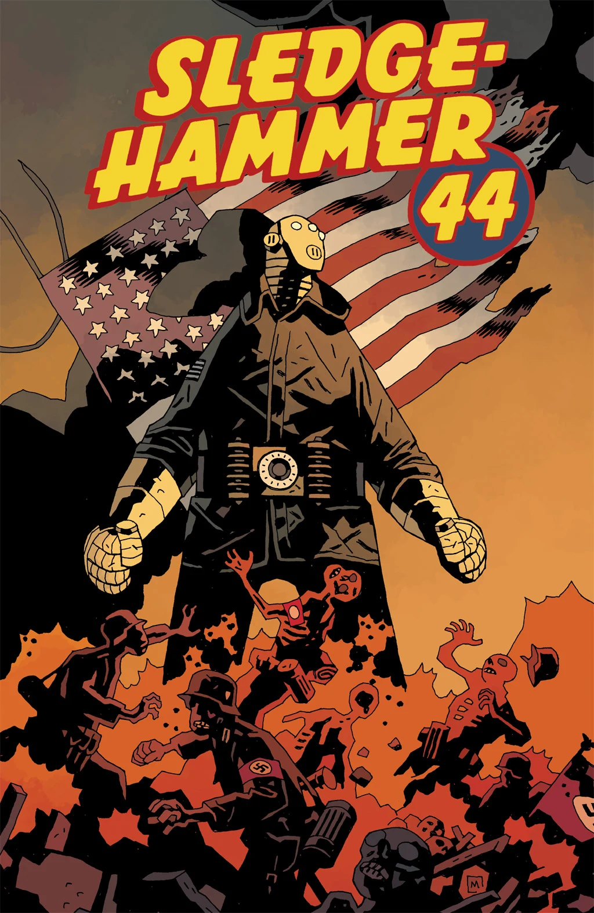

## Publication History

*Sledgehammer 44* is a two-issue miniseries published in March 2013 with art by Jason Latour. It is set during 1944, and while it is a part of the Hellboy Universe, it is not part of any established series. This is something brand new.

The story was originally written for John Severin as the artist before he died. <!-- missing image: Hellmail -->.](John_Severin's_Sledgehammer_44.png "450 px|center|A glimpse of John Severin's version of Sledgehammer 44 from Hellmail.")

## Synopsis

### Part One

August, 1944: a man in a [suit of iron armor](/entry/Vril%20Energy%20Suit) drops from an American warplane onto a French battlefield where he attempts to fight his way through an army of Nazis and the massive war machine they keep protected in an armory.

### Part Two

Outgunned and outnumbered by an army of Nazis, a group of GIs must band together and unleash the Hyperborean power of the mysterious man in the iron suit in order to make it home safely.

## Gallery

<File:Sledgehammer> 44 1.jpg|Issue \#1 <File:Sledgehammer> 44 2.jpg|Issue \#2

**Category:Story** **Category:Sledgehammer 44 story**