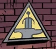

 The **Special Intelligence Directorate** was a British organization tasked with monitoring paranormal activity.

## Background

Not much is known about the S.I.D, only that they operated at least during the 1950s with the main headquarters in the disused Tower of London Underground Station. They were more secretive unlike their American counterpart, the [B.P.R.D.](/entry/Bureau%20for%20Paranormal%20Research%20and%20Defense) which acted publicly and were unaware of the existence of the British organization at the time. They seemed to possess an antagonistic relationship with the [S.S.S.](/entry/Special%20Sciences%20Service). Interestingly in 1884 a organization known as the [Foundry](/entry/Foundry) bears the S.I.D. the same anvil and sword symbol, hinting a connection.[1]

## History

In 1953 the S.I.D. contacted Professor [Trevor Bruttenholm](/entry/Trevor%20Bruttenholm), to assist in supposedly retrieving an artifact in Hong Kong. In reality the B.P.R.D was sent to clean a mess of the S.I.D's making when one of their agents went rogue. After Roland Childe reported to his superiors that the hunping was destroyed in Kowlon Walled City. Lady Cynthia Eden-Jones moved onto another issue, tracking two former operatives of the S.S.S.[2]

## Agents

- [Lady Cynthia Eden-Jones](/entry/Lady%20Cynthia%20Eden-Jones)
- Roland Childe
- Thomas Rhyme (formerly)
- Margery Daw

## References

<references />

**Category:Organizations**

[1] The Gates of Heaven

[2] *[Ghost Moon](/entry/Ghost%20Moon)*