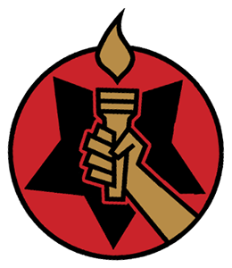

 The **Special Sciences Service** (S.S.S.) is a Russian organization tasked with protecting the Soviet Union (and later the Russian Federation) from occult, paranormal, and supernatural threats. The S.S.S. made its first appearance in *[B.P.R.D.: 1946](/entry/1946)* and has since become a major part of the [*Hell on Earth* story cycle](/entry/Hell_on_Earth_(story_cycle)))

## History

The Special Sciences Service was first seen in Berlin in 1946 after the Allies had occupied Germany. The S.S.S would begin a massive campaign to track down Nazi paranormal artifacts, weapons project and key occult figures. The Director of the S.S.S. during this period was a demon named [Varvara](/entry/Varvara), whose main goal was to seek any buried secrets the Nazis may have kept in Berlin, and to make sure the Soviet Union was ahead of the Allies in paranormal affairs. Under the leadership of Varvara the S.S.S was known for its harsh treatment of Nazi prisoners and the fear she instilled on the men serving her.

In 1946 Professor [Trevor Bruttenholm](/entry/Trevor%20Bruttenholm), Dr. Howard Eaton and a group of five American soldiers were investigating for records which were left behind by the Nazis when after hitting a series of dead ends. Bruttenholm would travel to the Soviet control section of Berlin to see if he was able to to convince the Soviets in sharing information. Once in the Soviet occupation zone, Bruttenholm would come in contact with the Special Science Service and Varvara. The S.S.S. later helped Bruttenholm and his team investigate Project Vampir Sturm and destroy its vampiric test subjects.[1]

For much of the Cold War the S.S.S. and the [Bureau for Paranormal Research and Defense](/entry/Bureau%20for%20Paranormal%20Research%20and%20Defense) were viewed as rivals and had limited contact. Though both the Directors of the B.P.R.D and S.S.S. had contact each other during the Cold War, neither agency would help one another as they did in Germany. In 1948 the S.S.S would come in possession of [Ugo Melchiorre's Burgonet](/entry/Melchiorre%27s%20burgonet) while digging through seized Nazi relics. Director Varvara would instill the safe keeping of the Burgonet to a young soldier named [Iosif Nichayko](/entry/Iosif%20Nichayko). Iosif was to transport the Burgonet back to Moscow then to Torshavn in a submarine, but the submarine would never make it to its destination, and it would sink off the coast of Norway killing all its crew on board. However, Iosif was the sole survivor and was resurrected as a zombie before being taken into S.S.S. custody.[2] Although mindless, Iosif soon regain sentience and served the S.S.S. before he somehow overthrown Varvara and made himself Director of the S.S.S.

The Special Science Services have recently entered into a working relationship with the Bureau for Paranormal Research and Defense. The two organizations have been sharing knowledge and resources to combat the growing threat of the Ogdru Hem.

## Composition

- [Iosif Nichayko](/entry/Iosif%20Nichayko) - current Director of S.S.S.
- Vasily - senior S.S.S. officer
- [Varvara](/entry/Varvara) - former Director of S.S.S. (imprisoned)
- Nicholas Verlacz - Medium and former Commander of Esoteric Teachings Division (deceased)
- [Dr. Lazar](/entry/Lazar) - former S.S.S. scientist (deceased)
- Dr. Khanin - former S.S.S. scientist (deceased)
- Dr. Tarasov - former S.S.S. scientist (deceased)
- Dr. Fedoseev - former S.S.S. scientist (deceased)
- Dr. Chuzhoi - former S.S.S. scientist (deceased)
- Professor Abezgauz - former S.S.S. scientist (deceased)
- Professor Panushkis - former S.S.S. scientist (deceased)

## References

<references />

**Category:Organizations**

[1] *[B.P.R.D.: 1947](/entry/1947)*

[2] *[The Abyssal Plain](/entry/The%20Abyssal%20Plain)*