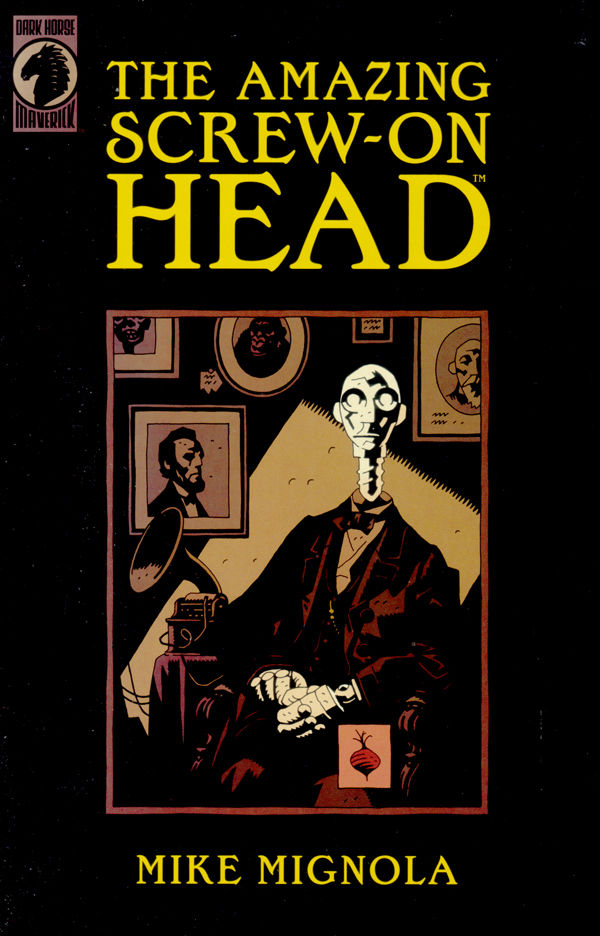

***The Amazing Screw-On Head*** is a one-shot story written and drown by [Mike Mignola](/entry/Mike%20Mignola).

## Synopsis

When Emperor Zombie threatens the safety of all life on Earth, the president enlists the aid of a mechanical head. With Screw-On Head and Mr. Groin on the job, you just know there will be flying machines to be piloted, tombs to be robbed, and weird alien menaces to be thwarted—all that and talking dogs, too! It's pure mayhem—and pure Mignola!

## Story within a Story

While not strictly canon, *The Amazing Screw-On Head* exists within the Hellboy Universe as a series of stories written by [Walter Edmond Heap](/entry/Walter%20Edmond%20Heap):

- *The Incredible Adventures of a Small Mechanical Head* (1899)
- *The Mechanical Head Returns* (1900)
- *The Mechanical Head Returns Again* (1902)

*[The Magician and the Snake](/entry/The%20Magician%20and%20the%20Snake)*, a short story collected with *The Amazing Screw-On Head* in *The Amazing Screw-on Head and Other Curious Objects*, is also a story within a story. Potentially other stories in that collection are also stories within the Hellboy Universe, such as *The Prisoner of Mars*, which seems to be another of Walter Edmond Heap's stories.

**Amazing Screw-On Head** **Amazing Screw-On Head**