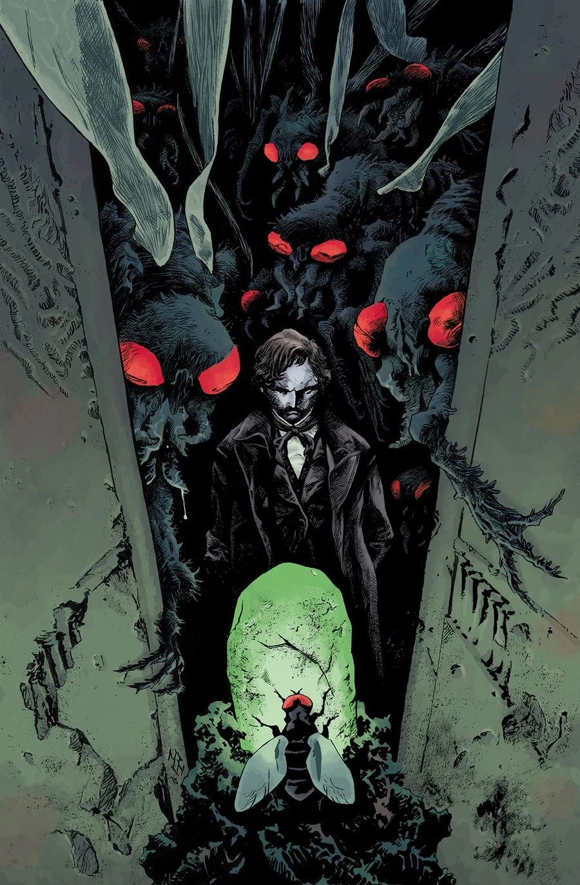
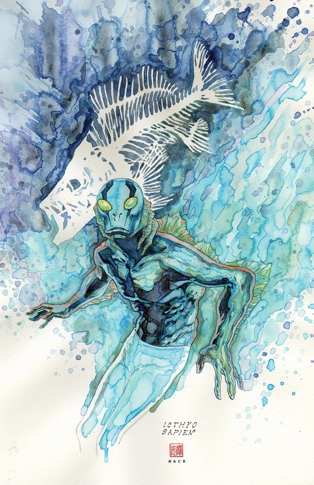

《**黑色学派**》（The Black School）是一部单期完结故事，由塞巴斯蒂安·菲乌马拉（Sebastián Fiumara）担任绘画。

## 剧情简介

我们的反派抵达了他的目标——传说中的黑色学派（Black School），两百多年前，他正是在这里开始了自己的修行。在这里，他将找到亚伯·萨皮恩本人多年来苦苦追寻的答案。施特罗布尔（Strobl）或许也能在这里找到他所需的捷径，以恢复自己在世界末日中应有的位置：站在魔鬼的右手边，奴役整个人类。

## 画廊

[马克斯·菲乌马拉](/entry/Max_Fiumara)（Max Fiumara）

[大卫·麦克](/entry/David_Mack)（David Mack）
