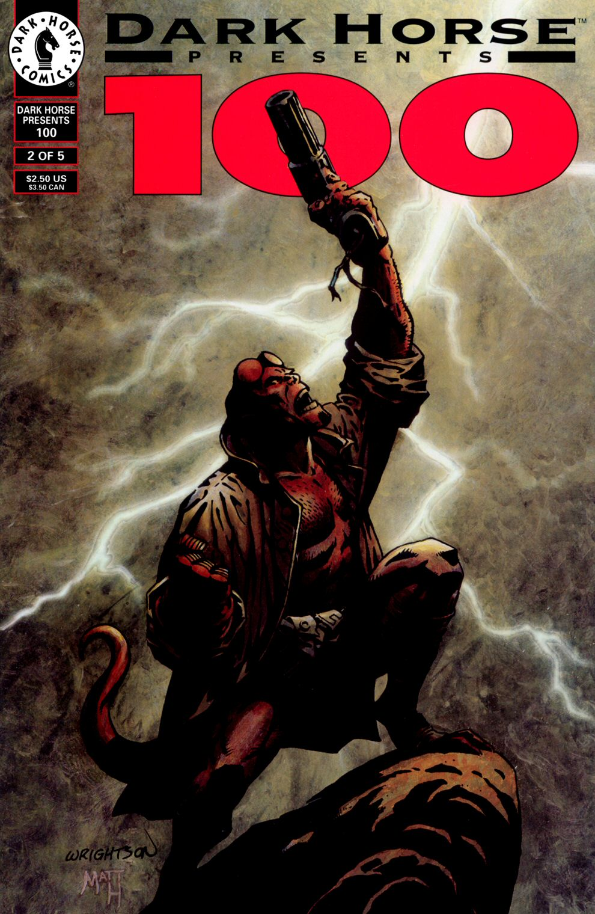

## Publication History

"The Chained Coffin" was published in black and white in *[Dark Horse Presents](/entry/Dark%20Horse%20Presents)* \#100–2 (Aug 1995). One month earlier, a three page preview had been published in "Dark Horse Presents \#100-0," an exclusive included with *Hero Illustrated* \#26. The story, with slight changes,[1] was reprinted in color in *[Hellboy: The Chained Coffin and Others](/entry/TPB)*, in August 1998.

## Synopsis

The story is framed by [Abe Sapien](/entry/Abe%20Sapien) reading a letter from [Hellboy](/entry/Hellboy%20%28character%29) about his travels back to the church in East Bromwich, the place of his "birth". Hellboy recounts that the psychic [Cynthia Eden-Jones](/entry/Lady%20Cynthia%20Eden-Jones) thought Hellboy's appearance was related to two spirits in the church and not a Nazi experiment.

Hellboy falls asleep in the church and dreams of a dying woman. The woman admits to having been a witch, but now she renounces her past and asks for God's forgiveness. The woman asks her children, a priest and a nun, to save her soul. She instructs them to chain up her coffin and guard it from the devil for three nights.

Hellboy awakes to see a vision of the priest and nun standing over a chained coffin. A [demon](/entry/Azzael) enters the Church, and after a brief confrontation, he kills the priest and nun. The demon reveals that the woman's "real child" is still unborn, conceived at Walpurgis-Nacht many years ago. The demon looks towards Hellboy while saying, "My favorite son." The demon takes the woman down to hell forever.

The story ends back with Abe Sapien asleep, dreaming of fish.

## Story Chronology

The story takes place shortly after *[Seed of Destruction](/entry/Seed%20of%20Destruction)*. Hellboy says this is his first time back to the Church in 50 years, this would place the story some time in 1995.[2] The story occurs after *[The Wolves of Saint August](/entry/The%20Wolves%20of%20Saint%20August)*, in early 1994, and before *[Wake the Devil](/entry/Wake%20the%20Devil)*, most likely in 1997.

## Notes

<references/>
! colspan = 3 | [Vol. 3 The Chained Coffin and Others](/entry/TPB)

**Chained Coffin, The** **Chained Coffin, The**

[1] On the 1st page, the original version contains a picture of a 'new born' Hellboy with the Army, and a picture of "Dr. Robert Carson." The text reads "Albert Einstein used to visit, and I met Doc Carson there years before he grew that giant head..." As reprinted the text reads "Albert Einstein used to visit, and I met Oppenheimer..." Doc Carson was a character created by [John Byrne](/entry/John%20Byrne) in *Danger Unlimited*

[2] Hellboy was 'born' Dec 23, 1944, 50 years later would be the end of Dec 1994 or more likely 1995