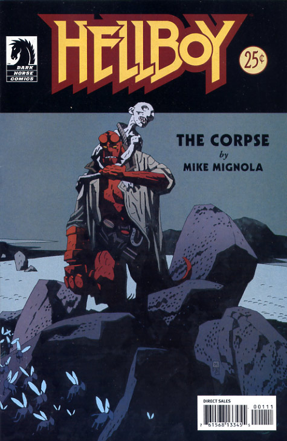

This relatively short story about Hellboy, a baby and a corpse, would become one of [Mignola's](/entry/Mike%20Mignola) favorites. Although seemingly a standalone story when first published, it has since become a major catalyst for events in *Hellboy* especially in *[Darkness Calls](/entry/Darkness%20Calls)* and *[The Wild Hunt](/entry/The%20Wild%20Hunt)*.

## Publication History

Most of *The Corpse* was originally published as 2 page installments in Capital City's Advance Comics catalogs \#75-82, between March and October 1995.[1] Then in January of 1996, the entire story was collected with a new opening page and an 8-page conclusion, in *The Corpse and the Iron Shoes.* This issue also premiered the story *[The Iron Shoes](/entry/The%20Iron%20Shoes)*. In August of 1998, the story was collected in *[Hellboy – Volume 3: The Chained Coffin and Others](/entry/TPB)*. As part of the lead up to the first [Hellboy Movie](/entry/Hellboy%20%28film%29), *The Corpse* was reprinted as a stand alone 25¢ comic in March of 2004, with 3 pages about the story's adaptation for use in the movie. Most recently, the story was offered as a DVD add-in with some editions of the Hellboy Movie.

## Synopsis

[Hellboy](/entry/Hellboy%20%28character%29) is called to Ireland in 1959, to deal with a child abduction. The child, [Alice Monaghan](/entry/Alice%20Monaghan) was replaced by the fairy, [Gruagach](/entry/Gruagach) in disguise. Hellboy burns Gruagach with iron, and forces him to reveal his true form. In order to get back the real child, Hellboy made an agreement with a group of little men Gruagach told him to lay the body of Tam O'Clannie to rest in a proper Christian grave. At the first two churches, the dead call out "No Room," and Hellboy is forced to continue on. [Dagda](/entry/Dagda), King of the Farie (introduced here for the first time), sees that Hellboy will succeed and orders one of the goblins to return the Monaghan child. Meanwhile, Gruagach seeks vengeance from Hellboy, and releases the boar-headed giant Grom, who immediately eats Gruagach. Hellboy fights Grom, and buries Tam. The deal completed, the fairy return the Baby to Hellboy, and the goblin tells him that they had intended to raise the child as their own because the Fairy can no longer have children, and now without Alice, it is only a matter of time before Dagda calls his kind away from the world forever.

## Story Chronology

The story takes place in 1959. This is the same year as Hellboy's fight with von Klempt, in ["World's Greatest Paranormal Investigator" (CBG)](/entry/World%27s%20Greatest%20Paranormal%20Investigator%20%28CBG%29) (1959), one year after *[The Penanggalan](/entry/The%20Penanggalan)* and *[The Crooked Man](/entry/The%20Crooked%20Man)* (1958), and two years before *[The Iron Shoes](/entry/The%20Iron%20Shoes)* and *[The Hydra and the Lion](/entry/The%20Hydra%20and%20the%20Lion)* (1961).

## Notes

<references />
! colspan = 1 | [Vol. 2 Wake the Devil](/entry/TPB) ! colspan = 2 | [Vol. 3 The Chained Coffin and Others](/entry/TPB)

**Corpse, The** **Corpse, The**

[1] See [http://www.completehellboy.com/the-archive/1991-1999/ The Hellboy Archive](http://www.completehellboy.com/the-archive/1991-1999/_The_Hellboy_Archive "wikilink")