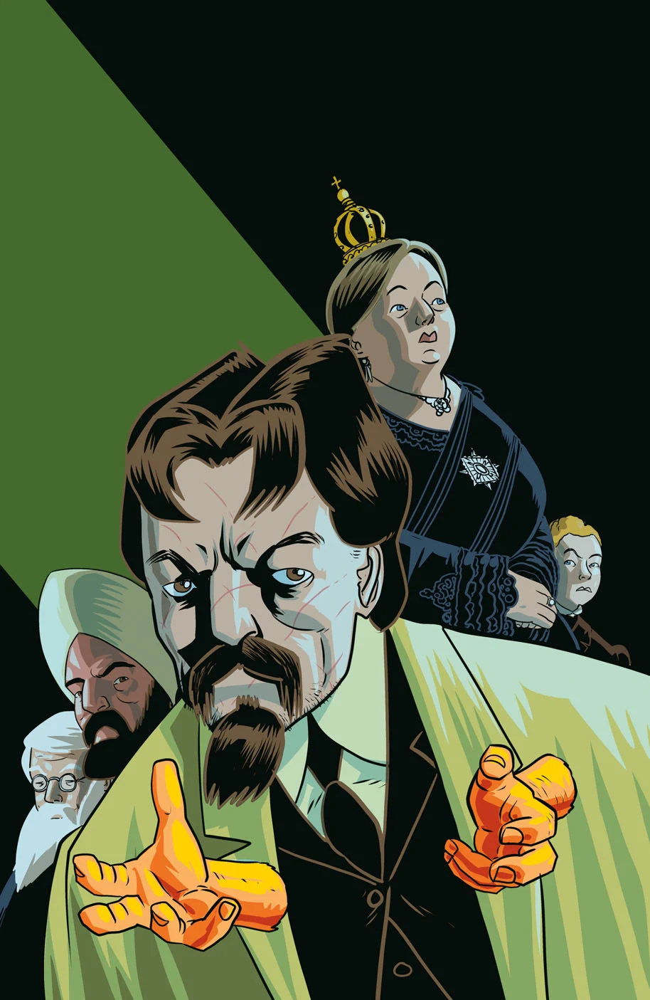

***The Gates of Heaven*** is a five-issue miniseries written by [Mike Mignola](/entry/Mike%20Mignola) and [Chris Roberson](/entry/Chris%20Roberson) with [D’Israeli](/entry/D%E2%80%99Israeli) on art duties.[1]

## Synopsis

### Part One

A series of occult events mystifies the man known as the Witchfinder, but even more surprising is the revelation that he is not alone in exploring the paranormal in London. When a personal invitation arrives from the palace, Sir Edward Grey is pulled even deeper into underground supernatural exploration alongside new allies in the race to stop a mad scientist from destroying London in his pursuit of mystical power.

### Part Two

Edward Grey starts to run out of leads when a familiar enemy tries to throttle his investigation. Meanwhile, the stakes only get higher as a ghostly thief continues to terrorize London.

### Part Three

The Witchfinder gets invaluable information from a strange source with ties to the Heliopic Brotherhood, meanwhile the supernatural activity in London hits a tipping point when a crazed, seemingly possessed man attacks people in the streets, and the dockside is thrown into an uproar when an enormous monster appears over the Thames.

### Part Four

A terrible loss draws the Witchfinder ever deeper into the hunt for the source of the supernatural terror gripping London. Recruiting new allies to his cause, Grey’s search brings him to the very doorstep of those responsible, but is he in time to stop their horrific scheme from engulfing the entire city in darkness?

### Part Five

Magic and science collide above London! The Witchfinder and his allies make a final stand when terror descends from the skies, and their nightmarish foe is finally revealed!

## Gallery

Covers by [D’Israeli](/entry/D%E2%80%99Israeli).

文件:The Gates of Heaven 1 DIsraeli.jpg|Issue \#1 文件:The Gates of Heaven 2 DIsraeli.jpg|Issue \#2 文件:The Gates of Heaven 3 DIsraeli.jpg|Issue \#3 文件:The Gates of Heaven 4 DIsraeli.jpg|Issue \#4 文件:The Gates of Heaven 5 DIsraeli.jpg|Issue \#5

## References

<references />
**Gates of Heaven, The** **Gates of Heaven, The**

[1] <https://geekandsundry.com/mike-mignola-and-chris-robersons-witchfinder-returns-in-the-gates-of-heaven-exclusive/>