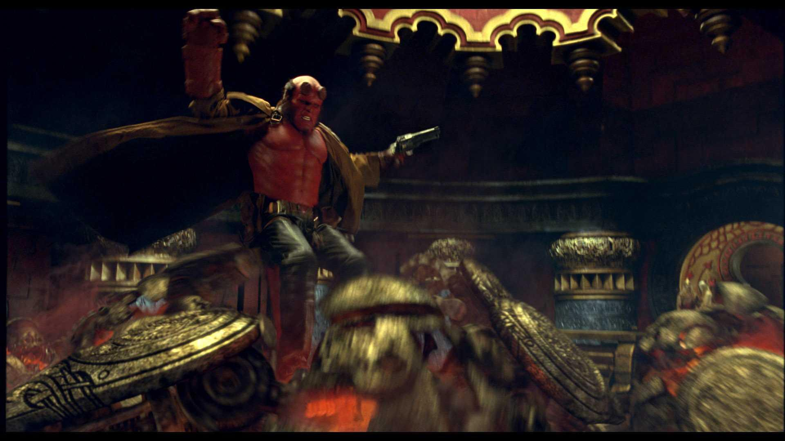

The **Golden Army**, the "unstoppable force", was a clockwork army composed of 70x70(4,900) soldiers. Far larger and stronger than any human, they could repair themselves from damage and were effectively indestructible. It was commissioned by King [Balor](/entry/Balor) during the war against the humanity. The Army can be controlled by the members of the royal family with [a golden crown](/entry/Crown%20of%20Bethmora), consisting of three pieces.

## History

The Golden Army came into being ages ago when a [a Goblin blacksmith](/entry/Goblin%20%28Bethmoran%29) suggested to King Balor of the Elves an army to fight off the humans that have expanding their territory while waging war against the fairy races. With his son [Nuada](/entry/Nuada) convincing him to allow it, Balor commissions the Golden Army's creation along with the only means to activate and control them: [Crown of Bethmora](/entry/Crown%20of%20Bethmora). However, as Balor learned too late from watching the complete destruction of the opposing army, the Golden Army are incapable of mercy and remorse. The Golden army did not distinguish between friend or foe—they had no mercy on the innocent human women and children.

The sight of the carnage convinced Balor to forge a truce with the humans and has the crown broken into three pieces while the Golden Army are deactivated and sealed in Bethmora, located in Northern Ireland, before it became a city of the dead.

 Centuries later, returning from his self-imposed exile, Nuada began to reassemble the Crown of Bethmora to bring the Golden Army back to life for the complete genocide of the human race. Though the [B.P.R.D.](/entry/B.P.R.D.) agents attempted to stop Nuada, they find themselves outnumbered and overwhelmed by the Golden Army. Luckily, being the son of the [Fallen One](/entry/Azzael), [Hellboy](/entry/Hellboy%20%28character%29) was able to challenge Nuada as the Golden Army enter standby mode to await the orders of the victor. Once [Liz Sherman](/entry/Liz%20Sherman) melted down the crown, the Golden Army was shut down as a result with the only known means to reactivate them gone forever.

de:Goldene Armee

**Golden Army** **Golden Army** **Golden Army**