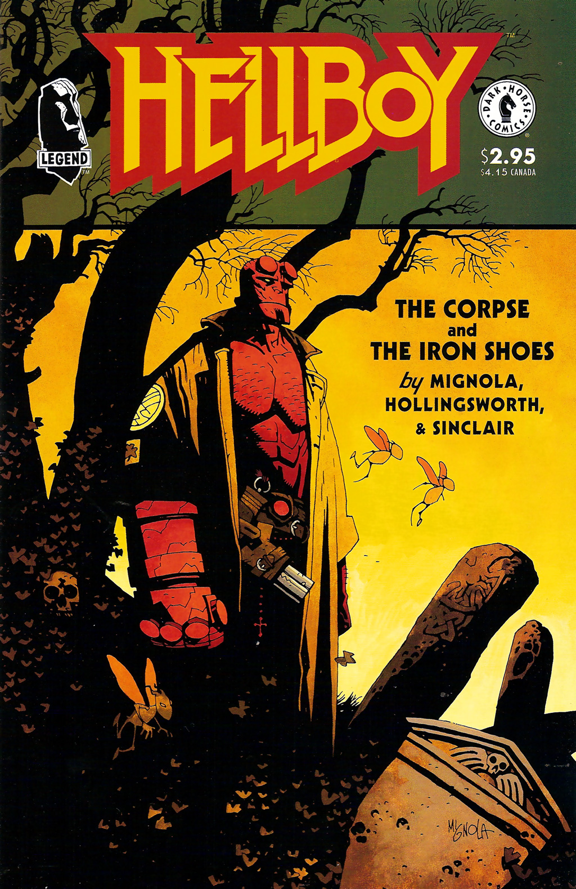

## Publication History

In January of 1996, when it was decided to collect *[The Corpse](/entry/The%20Corpse)* a new short story was needed to fill out the issue. The six-page story *The Iron Shoes* was created and *Hellboy: The Corpse and the Iron Shoes* was born. In August 1998, the story was collected in [*Hellboy – Volume 3: The Chained Coffin and Others*](/entry/TPB). [Mike Mignola](/entry/Mike%20Mignola) described it as not an actual story but just a weird encounter.

## Synopsis

The story opens with two Folklore experts, Edwin D. Wolf, and Katherine Boggs, who state that in gereral iron is potent against fairies and other supernatural creatures but that some, like Iron Shoes, are immune and actual use iron to their advantage. In Ireland in 1961, [Hellboy](/entry/Hellboy%20%28character%29) enters a ruined tower and is attacked by Iron Shoes who leaps out a window. Hellboy catches his neck with a lasso, and is pulled out of the tower. Then he drags Iron Shoes to a near by church. As the church bell tolls, Iron Shoes crumbles to dust leaving only his shoes behind. Hellboy leaves the shoes with the church's priest, and the story ends with the shoes sitting next to a statue.

## Story Chronology

The story takes place in 1961, the same year as *[The Hydra and the Lion](/entry/The%20Hydra%20and%20the%20Lion).*

*[The Corpse](/entry/The%20Corpse)* and ["World's Greatest Paranormal Investigator" (CBG)](/entry/World%27s%20Greatest%20Paranormal%20Investigator%20%28CBG%29) occurred two years earlier. In 1962 Hellboy met with [Cynthia Eden-Jones](/entry/Lady%20Cynthia%20Eden-Jones) shortly before she died,[1] on April 15th [Elizabeth Sherman](/entry/Elizabeth%20Sherman) was born in Kansas City, Kansas,[2] and on October 3rd Hellboy killed Black Annis, the cannibal hag[3] *[The Troll-Witch](/entry/The%20Troll%20Witch)* will take place two years later in 1963.

## Animated Version

A short animated version of "The Iron Shoes" was included on the DVD of [Hellboy: Blood and Iron](/entry/Hellboy%3A%20Blood%20and%20Iron) with the titular antagonist voiced by Dan Castellaneta.

## Notes

<references/>
! colspan = 3 | [Vol. 3 The Chained Coffin and Others](/entry/TPB)

**Iron Shoes, The** **Iron Shoes, The**

[1] as revealed in *[The Chained Coffin](/entry/The%20Chained%20Coffin)*

[2] as stated in *[Seed of Destruction](/entry/Seed%20of%20Destruction)* \#2 & *[Wake the Devil](/entry/Wake%20the%20Devil)* \#3

[3] as seen in *[The Wild Hunt](/entry/The%20Wild%20Hunt)* \#4.