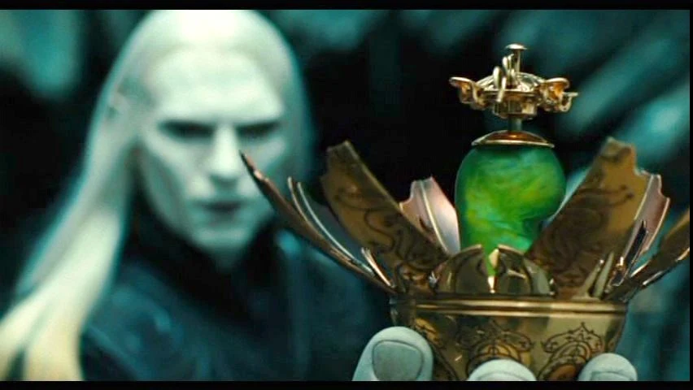
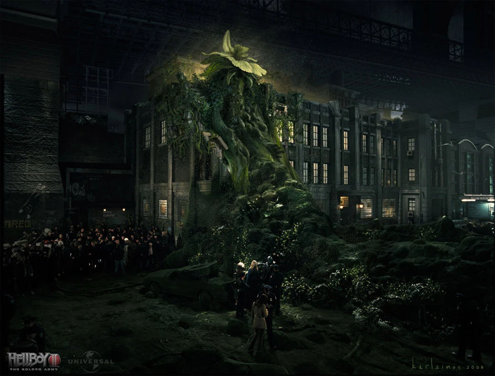

**The Last Elemental** (also poetically refered to as the Giver of Life and a Destroyer) is an elemental entity of Earth - a Forest God. Before [Hellboy](/entry/Hellboy) shot it dead, it was said to have been the last of its kind. The creature's only two appearances to date are in the movie-sequel Hellboy 2: The Golden Army, and its novelization.

## History

### Before the events of the movie

Nothing is known of the creature from before the events of the movie. It is implied that there had once been many more such creatures, and from the movie's backstory, one can presume they have all died out due to humanity's expansion on Earth, or during the war between humans and magical creatures.

The creatures were referred to as Forest Gods and as the Givers of Life and Destroyers. As such, it can be assumed that the Elves either worshipped, or still worship the Elementals as gods, and perhaps even believe them to be their creators. It is unknown if it was still the case during the time the events of the movie took place.

The Last Elemental has been kept safe in its passive seed-like form by the self-exiled elven [prince Nuada](/entry/Nuada).

### Nuada's return

 The seed is first seen in the movie as Nuada places it an a - presumably self-made - Goblin, egg-shaped container. He is informed of [Mr. Wink's](/entry/Mr.%20Wink) death, and takes the seed outside to confront Hellboy and his team. Once there, the prince unleashes the seed after ordering it to kill Hellboy, despite his sister ugring him not to do it. The seed then proceeds to hop towards a water source, and falls into a drainage canal.

Entering water, the seed begins to instantly germinate and in just a few minutes, the giant elemental creature bursts out into the streets, causing havok to the area by breaking vehicles and buildings, attempting to kill any and all nearby humans.

The creature's rampage was short however, as Hellboy managed to easily dispose of it in just three shots from the high-caliber shotgun called '[Big Baby](/entry/Big%20Baby)', after being goaded by prince Nuada into doing so.

After dying, the creature's 'blood' flooded the street, and began to instantly bloom into lush grass. The creature's 'head' likewise bloomed into a giant flower, and began spreading floating plant-seeds. 

## Powers and Abilities

In its seed-form, the creature already showed signs of intelligence, being capable of understanding speech, and even move by itself. It also had the capability of rapid germination and growth.

In its 'adult' form, the creature possessed imense physical strength, and was capable of lashing onto surfaces - although its unknown if this ability was not a side-effect of injury, or if the Elemental always had the ability but could not actually control it. The creature's 'blood' was highly potent at growing simple plantlife such as grass and small flowers, whereas its full-bloomed energy gangleon - its 'head', after its death - could produce floating plant-seeds.

It was also capable of its own speech, by 'speaking' gibberish as a seed, and by growling and growning as an adult.

## Appearance

The creature had two forms, based on its 'age'. Its 'baby' form was that of a green seed, or bean - as refered to by Hellboy. The 'adult' form was a towering - rougly 15 meters tall - humanoid with five tentacle-like limbs, a vine covered leaf-torso, and a flower-like head. The later consisted of a number of leaves covering a glowing energy gangleon that doubled as both its brain, and as a bud, that only bloomed into a flower after the creature's death.

## Trivia

- The creature was said to have been the last of its kind by prince Nuada.
- Being an elemental, or more specifically - a forest elemental, one can presume there are/ were other elemental creatures based on other elements.
- The creature's appearance was designed by Olivier Pron and Philippe Gaulier, and some of their sketches were featured in the book "Hellboy 2: The Art of the Movie".

**Last Elemental** **Last Elemental**