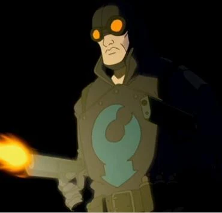

**The Lobster** was a vigilante who worked in secret in New York City during the 1930s. He had a reputation for violence, such as killing mobsters and burning his trademark lobster claw symbol into their foreheads.

In modern times, the general public believes the Lobster, popularly known as "**Lobster Johnson**," is only a fictional character created by a retired detective. However, he was a real man (though he was never referred to as "Lobster Johnson" in his own time. That name came later with the fictionalized version of him) who faced gangsters and paranormal threats.

He first appeared in the backup story *[Lobster Johnson: The Killer in My Skull](/entry/The%20Killer%20in%20My%20Skull)* that accompanied *[Hellboy: Box Full of Evil](/entry/Box%20Full%20of%20Evil)* \#1.

## History

### Vigilantism

The origins of the Lobster and his identity has since remained unknown and never been determined. His first appearance in the public was pinpointed to the death of gangster Donny "Mints" Parker with a claw-shaped seared into his forehead in February 1934. For the next four years, the Lobster and his allies had waged a one-man war on gangs, with over a hundred (by some accounts, as many as two-hundred and fifty) gang-related victims confirmed between 1932 and 1938, including such organized crime figures as Zuco Banana, Skinny Joe Lincoln, and Victor "Vicky the Fish" Cipriani. Late in the 1930s, the Lobster focus from his war on crime to international affairs, such as foiling the attempts of foreign agents, which mainly consists of Axis spies and saboteurs, operating in America, and paranormal threats.

In 1932, the Lobster became involved with mobster Arnie Wald, who has been dipping into mystically enhanced crimes. The conflict with Wald drove the mobster into hiring [The Black Flame](/entry/The%20Black%20Flame%20%28character%29).

In 1937, the Lobster came into conflict with the mysterious [Memnan Saa](/entry/Memnan%20Saa) in a plot to create an army of dragons and resurrecting the Hyperborean empire from using the secrets of Professor [Kyriakos Gallaragas](/entry/Kyriakos%20Gallaragas)'s work, "Anum's Fork". The Lobster saved Gallaragas' daughter Helena and Saa's plan was destroyed by Gallaragas' associate [Jim Sacks](/entry/Jim%20Sacks). However, Memnan Saa escaped and becoming a dangerous enemy of the Lobster.[1]

The Lobster sworn in pursuing Memnan Saa, but the leads came into dead ends and tragedy as the Lobster's allies suffered tragic deaths in finding Saa, which left only his ally [Harry McTell](/entry/Harry%20McTell). The losses forced the Lobster into abandoning his pursuit and subsequently began working as an independent agent for the United States government.[2]

### Working for the U.S. Government

In 1938, the Lobster was investigating a series of abnormal scientist murders in Upper New York City. A photo discovered in Dr. Skinner's apartment led the Lobster to the last remaining scientist of the original five employed by [Zinco-Davis](/entry/Zinco%20Corporation); [Stanley Corn](/entry/Stanley%20Corn). It is revealed that Stanley was the head of a top-secret research project at Zinco-Davis, but was fired as a result of his dangerous experiments on brains, including his own. Stanley then attempts to kill the Lobster, his assistant Bob, and the police through brain energy waves, but are successfully blocked by a jamming device. Subsequently, the Lobster shot Corn but only for Corn's brain to emerge and attempt to strangle the Lobster with its spinal cord. Fortunately, the Lobster manages to break free and smash the jamming device against it, causing an explosion and the "death" of the brain.

In February 1939, in one of his few unsuccessful missions, the Lobster failed in capturing a Nazi criminal, who killed his assistant and destroyed a train full of scientists bound for the Manhattan Project.

The Lobster's final mission was an unsuccessful attempt to prevent the Nazis from launching a space capsule at Hunte Castle in Austria on March 20, 1939. Although he managed to force the roof of Hunte Castle to close before the launch, the capsule managed to burst through. The subsequent explosion and fire within the castle killed everyone except Nazi scientist [Herman von Klempt](/entry/Herman%20von%20Klempt).

### Legacy

Ever since his demise, the Lobster inspired the public's imagination throughout the Second World War. The Lobster became a fictional character created in the pulp magazines published by [Norvell Cooper](/entry/Norvell%20Cooper) (who claimed to have met and work alongside the Lobster) and made briefly popular in a couple of movies such as *The Phantom Jungle* (Republic Pictures, 1945) in which he was portrayed by Vic Williams, and a string of low-budget horror movies produced by Mexican director Eduardo Fernandez. In recent years, it is suggested that the fictionalization of the Lobster was an effort by the U.S. government to cover up the vigilante's existence, in which [Hellboy](/entry/Hellboy) (a lifelong Lobster fan) believed it to be so.

In February 2001, the Lobster's spirit was encountered by [B.P.R.D.](/entry/B.P.R.D.) agents Hellboy and [Roger](/entry/Roger) in the haunted ruins of Hunte Castle. The Lobster was instrumental in stopping Herman von Klempt and [Rasputin](/entry/Rasputin)'s plot to bring the [Conqueror Worm](/entry/Conqueror%20Worm) to Earth, completing in death the mission he had failed to do in life. In the aftermath, the Lobster's bullet ridden, desiccated corpse was subsequently discovered by Hellboy and Roger, whom they give a burial for the restless vigilante.

However, the Lobster never did come to rest. In July 2003, the Lobster again helped Roger and [Liz Sherman](/entry/Liz%20Sherman) in resolving his failed 1939 mission and capturing the now aged saboteur. When Memnan Saa began to make his presence felt to the B.P.R.D. during the war against Sadu Hem's frog monsters, the Lobster briefly took possession of [Johann Kraus](/entry/Johann%20Kraus)'s ectoplasm in the wake of [Ben Daimio](/entry/Ben%20Daimio)'s disastrous end of relations with the team to break the hold Saa had gained over Liz. With something of his past association with Saa thus revealed, the team held a séance not long afterwards in which his spirit gave them their first clues in the search for Saa, using the information he had uncovered decades before in his investigations. When the B.P.R.D. finally traced Saa to his base somewhere on the Stanovoy Ridge, the Lobster again took possession of Johann's form in the closing moments of the denouement in an attempt to defeat his old nemesis. After Saa was killed and the Lobster's purpose has been fulfilled, [Kate Corrigan](/entry/Kate%20Corrigan) took him back to Hunte Castle in Austria, where he relinquished his hold on Johann's ectoplasm and rejoined the ghostly throng inhabiting the castle - having found his own sort of peace in an afterlife where he could continue his battle against Nazis and the forces of evil forever after.

## Powers and Abilities

The Lobster possesses a professional degree of physical combat and specialized in firearms, such as his trademark pistols. After killing his enemies, the Lobster would leave a "claw" brand which is attached to his glove, though it is unclear how exactly he heats it; it is most likely done through supernatural means.

Upon his death, the Lobster existed as a ghost and was able to turn fully tangible at any moment he chose. He has shown many times to appear in places that would normally be extremely difficult or impossible to reach, indicating that he can either teleport or become intangible/invisible. As in life, the Lobster continues to carry his trademark handguns in death, and they have lost none of their effectiveness. The Lobster also retains his "claw" brand.

As a ghost, the Lobster often demonstrates an aloofness or a sense of greater understanding. When Roger asks for his assistance in fighting the Conqueror Worm, the Lobster declines, telling Roger that it is a task that he (Roger) must do without him. It is likely that being a ghost has revealed several aspects of the universe to the Lobster that are unknowable to the living.

After the Lobster recharged Roger via a lightning bolt, he is reduced to a skeletal corpse clad in a battered version of his uniform/costume, hinting that the Lobster might still maintain his dead corporeal body even as a ghost.

## Trivia

The Lobster appearing in a teaser of <em>The Phantom Claw</em>.

- Lobster Johnson has a brief cameo in the second animated Hellboy film, *Blood and Iron* appearing during a flashback scene showing Hellboy's birth and [Malcolm Frost](/entry/Malcolm%20Frost)'s reaction to the creature. After the credits there is a teaser for the still unproduced third film *The Phantom Claw*, where he will assist Hellboy and [Kate Corrigan](/entry/Kate%20Corrigan) in battling the ghost of [Rasputin](/entry/Rasputin).
- The Lobster was meant to appear as a secret character in DLC for *Hellboy: Science of Evil*and was to be voiced by Bruce Campbell. Though the DLC was never made and he is only vaguely referenced in the main game.

## References

<references />

**Lobster, The** **Lobster, The** **Lobster, The** **Lobster, The** **Lobster, The** **Lobster, The** **Lobster, The**

[1] [The Iron Prometheus](/entry/The%20Iron%20Prometheus)

[2] The Black Goddess