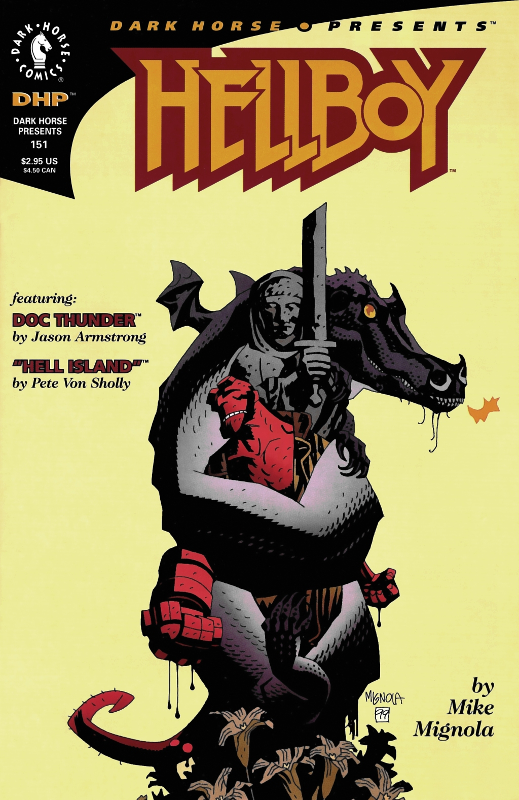

[Hellboy](/entry/Hellboy) is sent to slay a dragon.

## Publication History

"The Nature of the Beast" was published in black and white, as part of the *[Dark Horse Presents](/entry/Dark%20Horse%20Presents)* \#151, in February 2000. The story was reprinted in color in [*Hellboy – Volume 4: The Right Hand of Doom*](/entry/TPB).

## Synopsis

[Hellboy](/entry/Hellboy) travels to England in 1954. [Trevor Bruttenholm](/entry/Trevor%20Bruttenholm) has sent him to the [Osiris Club](/entry/Osiris%20Club), and they ask him to slay a dragon. They tell him the story of the Saint Leonard Worm, a dragon slain by a monk fourteen hundred years ago. The dragon had returned and it was on Hellboy to kill it. Hellboy enters Leonard's wood, and approaches a clearing with a statue of the monk. The dragon attacks Hellboy, and constricts him up against the statue. The dragon crushes Hellboy and the statue. The top of the statue breaks off, and the stone sword falls, killing the dragon.

Meanwhile, the Osiris Club had been watching Hellboy through a crystal ball. They comment that the experiment was inconclusive, and that they will have to continue to watch Hellboy to learn "his true nature."

## Connections to Other Stories

This story is referenced in *[Conqueror Worm](/entry/Conqueror%20Worm%20%28story%29)* \#2 and *[The Wild Hunt](/entry/The%20Wild%20Hunt)* \#1.

! colspan = 3 | [Vol. 4 The Right Hand of Doom](/entry/TPB)

**Nature of the Beast, The** **Nature of the Beast, The**