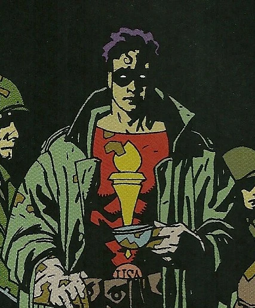

The **Torch of Liberty** was a costumed hero who fought Nazi forces during World War II.

## History

Torch of Liberty was created by [John Byrne](/entry/John%20Byrne) and featured in the backup story to *Danger Unlimited* \#1-4 (Feb-May 1994). The Torch was also featured in *Torch of Liberty Special* (Jan 1995). These stories reveal his origin as a soldier in World War II Europe, brought to great heights through trauma in combat.

### In Hellboy

During the "[Hellboy Incident](/entry/Seed%20of%20Destruction)", the Torch of Liberty accompanied Professor [Trevor Bruttenholm](/entry/Trevor%20Bruttenholm), [Malcolm Frost](/entry/Malcolm%20Frost), the psychic [Lady Cynthia Eden-Jones](/entry/Lady%20Cynthia%20Eden-Jones), U.S. Army 1st Sergeant [George Whitman](/entry/George%20Whitman), and his men.[1]

Afterwards, The Torch of Liberty trained [Hellboy](/entry/Hellboy) with his pistol, claiming he was the worst shot he had ever trained.[2]

## Future Appearances

Because the character is owned by [John Byrne](/entry/John%20Byrne), it is extremely unlikely that he will ever show up in a Hellboy story again. In response to a fan letter, editor [Scott Allie](/entry/Scott%20Allie) stated;

  
  
*The Torch of Liberty is the property of John Byrne, not Mike or Dark Horse, so, in order to keep these books all owned by Mike, we use characters he made up. John's busy elsewhere, so the Torch is gone if not forgotten.*[3]

## Notes

<references/>

pt-br:Tocha da Liberdade

**Torch of Liberty, The** **Category:Humans** **Category:Male Characters** **Category:Americans** **Category:Vigilantes** **Category:Hellboy characters**

[1] *[Seed of Destruction](/entry/Seed%20of%20Destruction)* \#1

[2] *[Seed of Destruction](/entry/Seed%20of%20Destruction)* \#3

[3] Hellmail, *[War on Frogs](/entry/War%20on%20Frogs)* \#4 (Dec 2006)