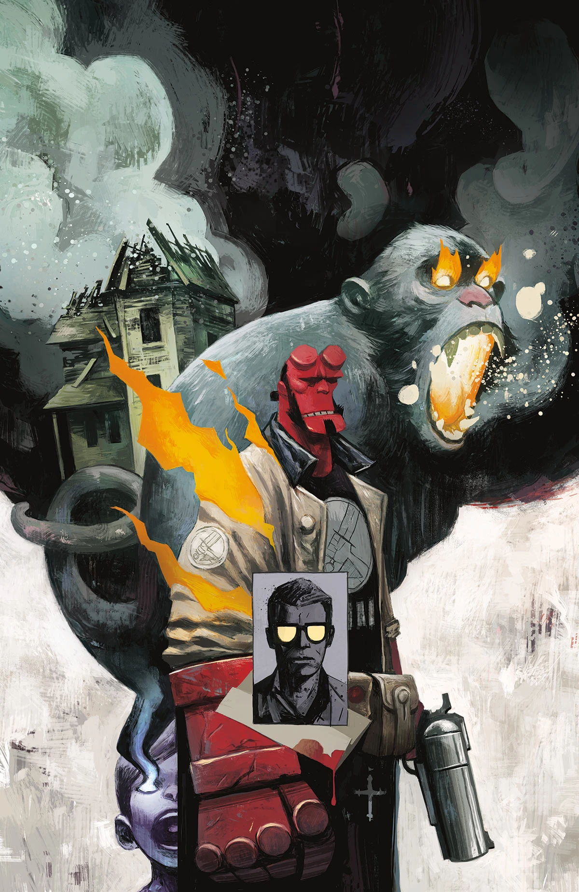

《**无理性之兽**》（The Unreasoning Beast）是《[地狱男爵与 B.P.R.D.](/entry/Hellboy_and_the_B.P.R.D.)：1954》的一个单期完结篇章，由迈克·米格诺拉（Mike Mignola）与克里斯·罗伯森（Chris Roberson）编剧，帕特里克·雷诺兹（Patric Reynolds）作画。

## 剧情简介

一次非同寻常的猎鬼任务，把地狱男爵引到一只幽灵猴子面前——它为一个深陷悲痛的家庭带来了一则讯息。

## 画廊

封面由 [迈克·赫德尔斯顿](/entry/Mike_Huddleston)（Mike Huddleston）绘制。

《无理性之兽》

**Category:Story** **Category:B.P.R.D. story** **Category:Hellboy story** **Category:Hellboy and the B.P.R.D. story**
