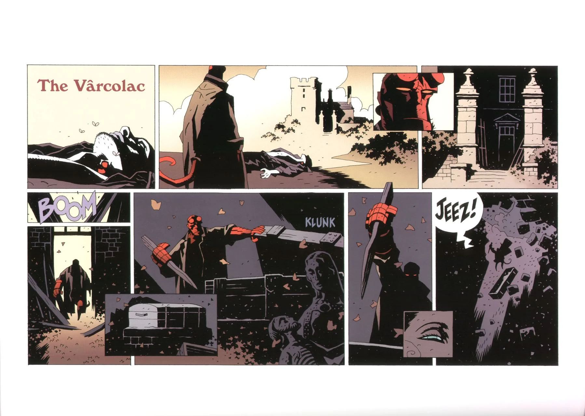

## Publication History

*The Vârcolac* originally ran as six one page installments as a part of *Dark Horse Extra* \#14-19, published between July 1999 and January 2000. This original version was in Sunday-newspaper-strip format. When the story was collected, [Mignola](/entry/Mike%20Mignola) decided to completely redraw the story so that it would be in standard comic format. The resulting 11 page story was published as part of [*Hellboy – Volume 4: The Right Hand of Doom*](/entry/TPB) in April 2000. The original version of the story was later reprinted in *[The Art of Hellboy](/entry/TPB)* in March 2003.

## Synopsis

[Hellboy](/entry/Hellboy) is in Yorkshire in 1982. He stands over a dead body, two bloody spots on its neck. Hellboy enters a rundown house nearby, finds the coffin of Countess [Ilona Kakosy](/entry/Ilona%20Kakosy), and stake in hand prepares to impale the vampire. However, just at that moment the floor gives out, and Hellboy plunges to the depths below. He lands before a group of coffins and a large group of ghouls grab Hellboy. Hellboy is pulled to the surface and an enormous winged figure is seen in the distance, the Vârcolac. Ilona describes the Vârcolac, and it scoops Hellboy up in its massive hand. At that moment Hellboy wakes up, the entire affair an illusion, a trick played by the Countess. Hellboy impales Ilona ending the story.

! colspan = 3 | [Vol. 4 The Right Hand of Doom](/entry/TPB)

**Vârcolac, The** **Vârcolac, The**