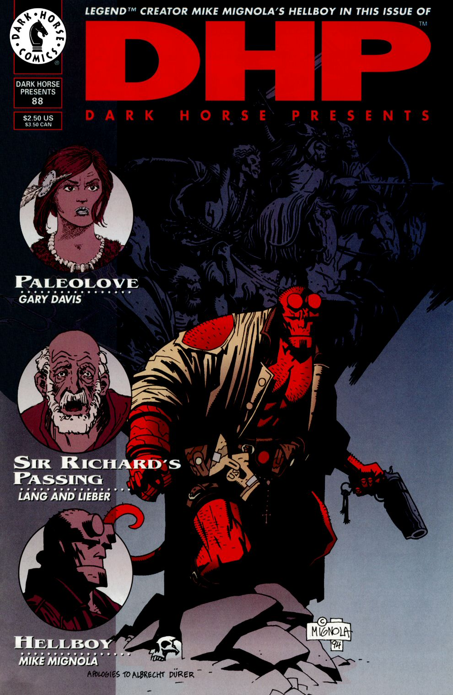

This story helped to expand the Hellboy world, introduced [Kate Corrigan](/entry/Kate%20Corrigan), a [B.P.R.D.](/entry/Bureau%20for%20Paranormal%20Research%20and%20Defense) consultant, and names Dr. Izar Hoffman who would appear other Hellboy stories.

## Publication History

*The Wolves of Saint August* was originally serialized in *[Dark Horse Presents](/entry/Dark%20Horse%20Presents)* \#88-91 (Aug-Nov 1994). Each issue contained eight black and white story pages. In November 1995, the story was collected in *Hellboy: The Wolves of St. August.* This 48-page prestige format graphic novel presented the story in color and added 8 new story pages. This expanded version was also reprinted in [*Hellboy – Volume 3: The Chained Coffin and Others*](/entry/TPB) (Aug 1998).

## Synopsis

The story opens in 1994 in the town of Griart. Father Kelly, the town's new priest, hopes to reopen an old chapel fallen into disuse. The Priest meets a man in the chapel, who explains that long ago the villagers trapped the royal family and killed them. The man then transforms into a wolf.

Nine days later, [Hellboy](/entry/Hellboy%20%28character%29) and [Kate Corrigan](/entry/Kate%20Corrigan) appear on the scene. Every person in the town has been killed by what appears to be a wild animal. Father Kelly's body had been found in the chapel. Kate sees an inscription in the chapel and realizes the true history of the town. The royal family had been cursed in 1214, so that they would transform into werewolves every seven years. The villagers caught the family while changed, and killed them. However one child, William, survived.

Hellboy is confronted by William, the man who killed Father Kelly earlier. William rips off his skin revealing a massive werewolf. The two fight and in the end Hellboy kills the Monster.

The final page notes that Dr. Izar Hoffman and a team of BPRD psychics later declared the site free of paranormal activity.

! colspan = 3 | [*Hellboy – Volume 3: The Chained Coffin and Others*](/entry/TPB)

pt-br:The Wolves of Saint August

**Wolves of Saint August, The** **Wolves of Saint August, The**