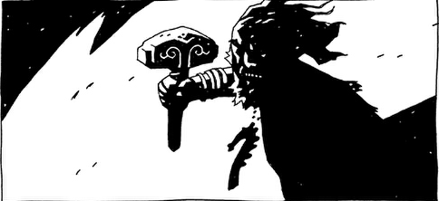

 **Thor** was a member of the Aesir, a race of gods from Norse mythology. He was the god of thunder and was known in life as the Thunderer.

## History

### Pre-Hellboy

At the climax of the Ragnorak, Thor stood at the battlefield with the rest of his kin against the enemies of his kind. He fought to the death against Jormungand.

### The Bones of Giants

Thor's body would eventually be buried in the wilds near Stockholm. It was discovered by a fisherman after a landslide uncovered his body.

Hellboy and Abe Sapien were invited by the Swedish government to examine the body, as they also had uncovered his legendary hammer, Mjollnir. While the archaeologists were unable to lift it from the tomb, Hellboy was able to as he was drawn by it. Lightning struck the paranormal investigator freeing the hammer and at the same time allowing the spirit of Thor to inhabit Hellboy. Thor's body was moved to the morgue for study, however Fredick Klar the Swedish burecrat attempted to burn it, seeing it as an abomination. Thor's body immediately rose from the table and was met by bullets by Klar's men.

However retribution came in the form of Mist, a valkyrie, who had come to claim the shell of Thor. Seeing the desecration of the dead, she speared the humans before vanishing taking his remains.

### Darkness Calls

Gruagach and his cohorts sought the remains of Nimue, who laid beneath a monastery. After killing the monks, and digging to the underground chamber, they found the vault. Gruagach used his hammer to crack open the vault, though his companions expressed their concerns of his sucess, His response was that Thor's hammer was no greater than his.

### The Fury

During Hellboy's confrontation with Nimue, three witches mistook him for Thor due to his stone hand.

## Source

**Category:Characters** **Category:Male Characters** **Category:Deities** **Category:Deceased Characters** **Category:Immortals**