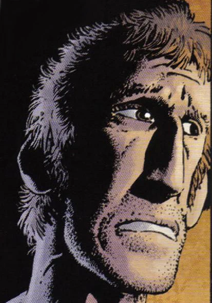

**Tom Ferrell** was born around 1923 in the Appalachian mountains near The Hurricane to a mother we know little of and a father who had a habit of drinking in the back woods. His early misadventures with witchcraft led to a self-imposed exodus. His return 20 years later proved to be a blessing as he and [Hellboy](/entry/Hellboy) lifted at least the curse of [Jeremiah Witkins](/entry/Jeremiah%20Witkins) and his witches from the area.

## History

### Early years and exodus

Tom grew up as a hillbilly youth, at age fifteen he had, in his own words, all the sense of a sack of snails. Yet he wasn't an evil person. He got his brush with the dark side when he espied [Effie Kolb](/entry/Effie%20Kolb) bathing. She first taught him a few things of the female body and then sought to turn him to witchcraft. Tom, being fifteen and not very sensible, thought it would be a great way to spend time. So he found a squashed black cat, boiled the meat off and washed the bones clean. According to Effie, [the devil](/entry/Satan) would show up and the [bone](/entry/Lucky%20cat%20bone) he had hold then would be filled with power.

Tom sees the devil and recognizes him as [Jeremiah Witkins](/entry/Jeremiah%20Witkins). He then realized he's been a fool and fled for home, only to see a toad on the doorstep, waiting for him. He recognizes it as a demon familiar sent by Witkins and leaves home without saying a word. He makes his way to a port, eventually enlists in the army and survives combat against the Japanese in the Second World War. Though he can't prove it, he suspects his lucky bone carried him safely through several scrapes.

### Return home and showdown

Tom returned home after having been gone for twenty years to find Hellboy peering at a witched girl's body and offers his advice and knowledge. The locals informed him that his mother is dead, having been relocated by a relative years ago and that his father went missing the day after he did. The two of them travel to [Cora Fisher](/entry/Cora%20Fisher)'s cabin while swapping life stories. They confront Cora who repents, but are then hailed by Effie who hasn't aged when he last saw her and claiming Witkins wants words with him. The horse she had ridden turned out to be Tom's father.

Tom then decided to have it out with the demon, after burying his father at the church. During the trip Tom is forced to use the bone to deliver them to safety, but he regrets it as it makes him a witch. A heated showdown at the church ensues, but Tom, Hellboy, Cora's Ghost and [Reverend Watts](/entry/Reverend%20Watts) prevail. The reverent imbues the bone with holy spirit and blessed a shovel with it. Hellboy strikes Witkins down and the witches flee.

Tom and Hellboy then make their way to the miser's home and he throws the bone at him, vanquishing him for good.

## Powers and abilities

Tom has enough knowledge of witchcraft to identify a witch ball and suggest a cure for it. He is quite knowledgable of his old home turf. He carried a [Lucky cat bone](/entry/Lucky%20cat%20bone) for decades that protected him from harm and allowed him to teleport two to safety. He also has had some army training honed by participating in World War II.

## Trivia

- Tom Ferrell is based on the character Silver John created by Manly Wade Wellman.
- Tom thought Hellboy was a cute little monkey when he saw the photo in the may 1948 issue of *Time* magazine.
- Tom had blamed himself so for the misdeeds caused by Effie and her master he almost turned himself over to them.

**Category:Characters** **Category:Witches** **Category:Male Characters** **Category:Humans** **Category:Americans**