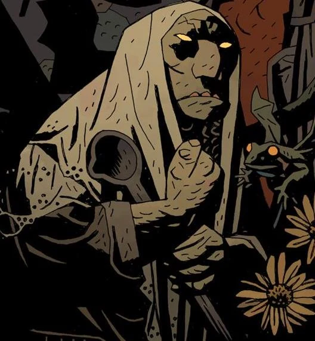

The **Troll Witch** is an ancient witch from Norway.

## History

Many years ago their was once a woman who could bare no children. Despairing she turn to a witch who gave her two flowers, and warned her only to eat the beautiful flower. The woman did what she was told and in a short time gave birth to a beautiful baby girl. Though she was satisfied her husband wanted a son, so she ate the second flower and gave birth to a second girl. However unlike her first daughter this bay was stunted, trollish and ugly.

As the two grew the first daughter became more beautiful while the second daughter became more dreadful. But despite their looks the two sisters loved each other and were inseparable.

On one Christmas Eve, trolls came to celebrate their Yule celebration. The mother warned the sisters to stay inside. The second sister did not listen and instead fought with the trolls. The first sister had tried to look for her sister, but a troll swapped her head with that of a cow turning her into a cow.

Angered the second sister, took revenge on the trolls. Using a wooden spoon she murdered them and reclaimed her sister's head. However her sister was still a cow and died as one. The girl would become the Troll Witch, whenever a woman wished for a child she would go to her and receive a flower, and the children that would be birthed would be beautiful.

In 1963 Hellboy paid her a visit to her cottage after the locals directed him to her. He told her he was here to investigate a series of gruesome murders concerning children. The acts of violence were too brutal to be made by the hands of men. She explained to Hellboy that the murders were the acts of trolls. She agreed to help him to stop them, giving him her old wooden spoon she used long ago to kill their kin. If he placed in at the door of their lair, they would not cross, allowing the sunlight to turn them to stone.

Before he left she asked cynically how Hellboy felt to resolve this issue without spilling a drop of blood, hinting at his role in the end of the world.

## Powers & Abilities

The Troll Witch had numerous familiars that allowed her to know what was happening in the world, especially about Hellboy. Unlike normal witches she used her powers for good and had a concern for the innocent.

**Category:Characters** **Category:Female Characters** **Category:Witches**