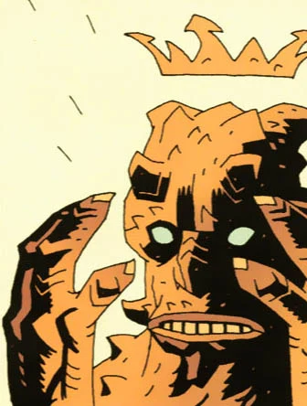

**Ualac** is a minor demon who appears in the Hellboy story: "[Box Full of Evil](/entry/Box%20Full%20of%20Evil)."

## History

Ualac is first mentioned in a letter that Pope Gregory VII wrote to the Bishop of Milan in 1802 which told of a demon attempting to seduce a blacksmith in the form of a woman. The blacksmith, would later come to be known as Saint Dunstan, saw through Ualac's guise and grabbed him by the ankle with red hot tongs before forcing the demon's head on his anvil to beat it with a hammer. Dunstan was eventually able to trap Ualac in a box and seal it with holy symbols.

The warlock [Igor Bromhead](/entry/Igor%20Bromhead) delivered this box to Count Guarino and his wife Bellona, Satanists who believed Ualac was the devil, along with the key to unlock it. Once opened, Ualac emerged from the box as a fly and possesses Bellona and turned the Count into a monkey. The demon attempted to curse Bromhead as well, but Igor came prepared with a charm to ward the curse and with Saint Dunstan's tongs while revealing that he knows Ualac's true name to force the demon to serve him.

Ualac immediately informed Bromhead of the presence of [Hellboy](/entry/Hellboy%20%28character%29) and they hatched a plot to steal his power and kill him. Bromhead was able to bind Hellboy by using his real name Anung Un Rama, allowing Ualac to steal the Crown of the Apocalypse and assume Hellboy's role as the Beast of the Apocalypse. But this changes Ualac, increasing his size and power to the point that he is no longer effected by Saint Dunstan's tongs as he changes them into a sword to take the Right Hand of Doom as well.

Fortunately, slipping into a vision where he was given some very helpful advice by a leprechaun, [Dagda](/entry/Dagda), and [Sir Edward Grey](/entry/Sir%20Edward%20Grey), Hellboy learns that he is no longer bound by his true name as he defeats Ualac by destroying his vessel and grabbing the demon when he attempts to flee in fly form. Summoned by Bromhead in an attempt to protect himself, [Astaroth](/entry/Astaroth) re-imprisoned Ualac while taking the Crown of the Apocalypse to Hell.

**Category:Demons** **Category:Characters** **Category:Male Characters** **Category:Hellboy characters**