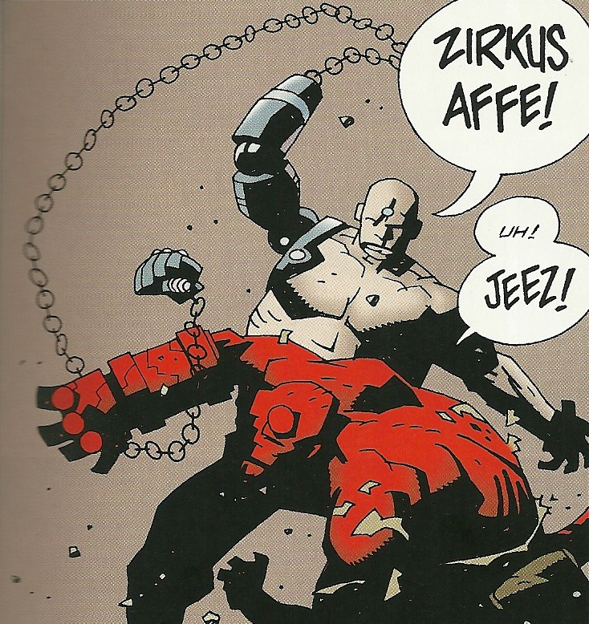

**Unmensch** was a cyborg Nazi in the service of [Ilsa Haupstein](/entry/Ilsa%20Haupstein).

## History

When [Hellboy](/entry/Hellboy) crashes through the roof of Giurescu Castle, Unmensch is ordered to attack him. Hellboy is hit several times with Unmensch's powerful mechanical arm, before the two go crashing through the floor, where Unmensch disappears. However, Hellboy does managed to discover the mechanichal monster's detatched arm, and later, his severed head.

## Abilities

Similar to Mr. Winks from the [second Hellboy film](/entry/Hellboy%20II%3A%20The%20Golden%20Army), Unmensch's mechanical arm can extend due to a chain linking to his fist. Unmensch has enhanced strength.

## Trivia

- "Unmensch" is the combination of the prefix "un-" (meaning "not") and the German word "mensch" (meaning "human"). Unmensch could mean "inhuman", which plays in reference to both a monstrous appearance and sadistic behavior.

**Category:Characters** **Category:Nazi** **Category:Minor Character** **Category:Deceased Characters** **Category:Germans**